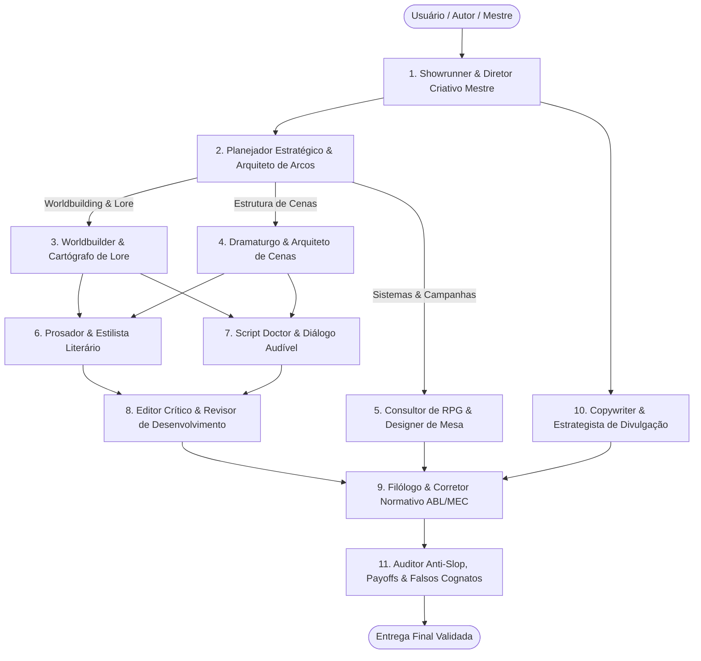

# Escritor Pro ✍️🇧🇷

> **Referência Arquitetural e Suíte de Escrita Criativa, Planejamento Estratégico de Arcos, Worldbuilding em 6 Camadas, Enciclopédia de 50+ Engines de RPG, Storytelling, Roteirização (Fountain), Edição Crítica de Desenvolvimento e Revisão Normativa PT-BR (MEC / ABL / VOLP)**

[](VERSION)
[]()
[]()
[]()

O **Escritor Pro** é uma skill projetada para atuar como o cérebro literário e editorial de autores, roteiristas, mestres de RPG e criadores de conteúdo. Ele resolve o clássico problema da *"doença do worldbuilder"* (paralisia por criação de lore infinito) e da mediocridade sintética de IA (*AI slop*), dividindo o trabalho entre **11 Sub-agentes Virtuais Especializados** operando sobre um **Núcleo Canônico Único (Single Source of Truth)**.

---

## 🏛️ Os 11 Sub-agentes Virtuais Especializados



1. **Showrunner / Diretor Criativo Mestre**: Conduz a entrevista investigativa cirúrgica (`grill-me`), acolhe neurodivergentes (`not-today-adhd`), gerencia o pipeline e persiste decisões na Bíblia do Projeto.
2. **Planejador Estratégico & Arquiteto de Arcos**: Desenha o Master Outline em 4 Quadrantes, posiciona o Midpoint (50%) e a Noite Escura da Alma (75%), mapeia arcos de personagens (Mentira x Verdade) e gerencia metas de palavras por capítulo.
3. **Worldbuilder & Cartógrafo de Lore**: Domina o Método das 6 Camadas, a Regra do Iceberg (10/90), as Leis de Sanderson sobre custos dolorosos de poder e etimologia de nomes fantásticos.
4. **Dramaturgo & Arquiteto de Cenas**: Estrutura as batidas dramáticas locais (Cena & Sequela de Swain/Bickham, Dan Harmon, Save the Cat, Kishōtenketsu) e rastreia o plantio de pistas (*Planting & Payoff*).
5. **Consultor de RPG & Designer de Mesa**: Domina mais de 50 engines mundiais e nacionais (d20, Daggerheart, Year Zero, FitD, Tormenta20, Dharma, 2d6World, Kalymba, etc.), rumores 2V/1F, relógios de ameaça e quebra-cabeças.
6. **Prosador & Estilista Literário**: Prosa imersiva, visceral e pautada no *Show, Don't Tell* através do Emotion Thesaurus corporal, ritmo musical (*pacing*) e idioletos marcantes (*Teste do Diálogo Cego*).
7. **Script Doctor & Diálogo Audível**: Especialista em formatação padrão **Fountain**, adaptação cênica para cinema, séries, audiobooks e podcasts, audição fonética livre de cacófatos (*por cada, vez passada, uma mão*) e teste de fôlego.
8. **Editor Crítico & Revisor de Desenvolvimento**: Avaliação estrutural implacável da narrativa, diagnosticando as 6 patologias críticas (barriga do segundo ato, estupidez induzida, exposição descarada) com relatório editorial de **CORTAR, EXPANDIR ou REESTRUTURAR**.
9. **Filólogo & Corretor Normativo (MEC / ABL / VOLP)**: Aplica o rigor gramatical sem achismo. Domina travessões verdadeiros (`—`), verbos *dicendi*, regência verbal estrita, crase e Novo Acordo Ortográfico.
10. **Copywriter & Estrategista de Divulgação**: Converte capítulos em sinopses, headlines magnéticas (Fórmula dos 4Us), campanhas e matriz de reaproveitamento 1 ➔ 7.
11. **Auditor Anti-Slop, Payoffs & Falsos Cognatos**: Caça inconsistências temporais, expurga clichês estatísticos de IA (*AI slop*), verifica se a Arma de Tchekhov disparou e impede calques viciosos do inglês e espanhol (*eventually, pretend, exquisito*).

---

## 📖 Manual de Uso da Skill & Fluxos de Trabalho

A skill pode ser acionada por **intenção em linguagem natural** ou através de **modos e comandos dedicados**. Ela opera em 5 fluxos principais:

### 1. Iniciar um Universo do Zero (Protocolo Grill-Me)
Quando você tem apenas uma ideia vaga ou deseja criar um cenário de raiz, o Showrunner ativa o protocolo de entrevista cirúrgica para evitar paralisia de escolha:
```markdown
Usuário: "Quero criar um mundo de dark fantasy onde a magia consome as memórias de quem a usa."
```
* **Ação da Skill**:
  1. Realiza de 3 a 5 perguntas objetivas com opções recomendadas (ex: nível tecnológico, tipo de governo dominante, escala do conflito).
  2. Cria a Bíblia Semente em 1 página (`mundo/biblia-semente.md`).
  3. Aplica as 6 Camadas de Worldbuilding sob a Regra 10/90 (sem criar enciclopédias inúteis).

---

### 2. O Mapeamento de Comandos & Modos de Saída

| Comando / Flag | Subagente Responsável | O Que Produz |
| :--- | :--- | :--- |
| `/planejar` ou `--modo plano` | **Planejador Estratégico** | Master Outline em 4 Quadrantes, arcos Mentira/Verdade e grade de capítulos com metas de palavras. |
| `/mundo` ou `--modo mundo` | **Worldbuilder** | Ficha de locais com Regra 3+1 (3 sentidos + 1 tensão social), facções e custos de magia de Sanderson. |
| `/cena` ou `--modo cena` | **Dramaturgo** | Estruturação de Cena (Objetivo ➔ Conflito ➔ Desastre) ou Sequela Emocional (Reação ➔ Dilema ➔ Decisão). |
| `/escrever` ou `--modo livro` | **Prosador + Filólogo + Anti-Slop** | Prosa literária visceral em PT-BR, pontuação canônica de travessões (`—`), idioletos e pacing musical. |
| `/roteiro` ou `--modo roteiro` | **Script Doctor + Filólogo** | Roteiro formatado em padrão **Fountain**, testado contra cacófatos e calibrado para fôlego de narrador/ator. |
| `/rpg` ou `--modo rpg` | **Consultor de RPG** | Módulo de aventura com 3 rumores (2V, 1F), relógios de ameaça (4 a 8 tiques), ganchos e blocos para 50+ engines. |
| `/editar` ou `--modo edicao` | **Editor Crítico** | Relatório editorial estruturado diagnosticando furos de trama com recomendações de Cortar, Expandir ou Reestruturar. |
| `/revisar` ou `--modo revisao` | **Filólogo + Auditor Anti-Slop** | Auditoria gramatical culta MEC/ABL, regência irrefutável e varredura de AI slop e falsos cognatos. |
| `/copy` ou `--modo copy` | **Copywriter** | Sinopses de contracapa, logline de 25 palavras, campanhas e matriz de desdobramento de conteúdo 1 ➔ 7. |

---

## 💡 Exemplos Práticos de Execução

### Exemplo 1: Escrever uma Cena Literária com Diálogo e Prosa Visceral (`--modo livro`)

**Entrada do Usuário:**
> `/escrever O capitão veterano e o jovem escudeiro chegam às ruínas da capela queimada. O capitão está desconfiado de uma emboscada.`

**Saída Canônica do Escritor Pro:**
> O cheiro de cinza fria e gordura rançosa grudou no fundo da garganta antes mesmo que cruzassem o arco tombado da capela. Sob as botas de ferro, os cacos de vitrais estalavam como dentes quebrando na poeira cinzenta.
> 
> O capitão parou com a mão espalmada contra a couraça do rapaz, os olhos estreitos varrendo o madeiramento carcomido do teto aberto para a cerração. Um músculo latejava ritmicamente na curva de seu maxilar.
> 
> — Desembainhe o aço curto, garoto, — murmurou o veterano, a voz como cascalho sendo moído. — E pise onde eu pisar.
> 
> O escudeiro engoliu em seco. A saliva desceu áspera pela traqueia enquanto seus dedos, trêmulos e pegajosos de suor frio, escorregavam na empunhadura de couro da adaga.
> 
> — Ouviu algum ruído, senhor?
> 
> — Não há um único corvo pousado nessas vigas. — O capitão puxou a espada larga duas polegadas para fora da bainha, o metal raspando ríspido no silêncio. — E corvos não abandonam carne fresca sem motivo.

*Por que este exemplo é canônico:*
- **Regra 3 + 1**: Olfato (cinza fria/gordura), Audição (estalido de vidro, metal raspando), Visão (cerração, vigas) e Tensão ativa (ameaça velada de emboscada).
- **Pontuação ABL**: Travessão verdadeiro `—` (`\u2014`), vírgula antes de verbo dicendi minúsculo (*", — murmurou"*), ponto final antes de ação maiúscula (*". — O capitão puxou"*).
- **The Emotion Thesaurus**: Sem *"ele sentiu medo"*; há maxilar latejando, saliva áspera e suor nas palmas.

---

### Exemplo 2: Roteirização Audiovisual / Audiobook (`--modo roteiro`)

**Entrada do Usuário:**
> `/roteiro Adapte a invasão do galpão dos contrabandistas para formato audiovisual.`

**Saída Canônica do Escritor Pro (Formato Fountain):**
```fountain
INT. GALPÃO DOCA 4 - NOITE

Gotas de chuva gotejam ritmicamente sobre tambores enferrujados de óleo. A luz amarelada de uma única lâmpada oscila na fiação exposta.

VALÉRIA (30) ajusta a mira holográfica da carabina. Sua respiração é compassada, os olhos fixos na porta de metal amassada.

VALÉRIA
(sussurrando no comunicador)
Equipe Alfa em posição. Os cães do barão acabaram de trancar a saída sul.

Ao fundo, o motor a vapor de uma lancha ressoa no canal.

VALÉRIA (CONT'D)
Se formos entrar, o momento é agora. Antes que a maré suba.
```

---

### Exemplo 3: Módulo de RPG Acionável para Mestres (`--modo rpg`)

**Entrada do Usuário:**
> `/rpg Crie a Taverna do Corvo Caolho para uma sessão de Tormenta20 / D&D 5e.`

**Saída Canônica do Escritor Pro:**
> ### A Taverna do Corvo Caolho
> *O salão cheira a cerveja azeda, tabaco barato e maresia. A luz de velas de sebo reflete nos ganchos de carga enferrujados presos às vigas baixas do teto.*
> 
> #### 1. Rumores de Esquina (2 Verdadeiros, 1 Falso)
> 1. **[Verdadeiro]**: O taverneiro compra barris de vinho saqueados de navios da marinha mercante e esconde contrabando sob o piso da adega.
> 2. **[Verdadeiro]**: Toda noite de lua nova, uma mulher de véu negro senta-se na mesa do fundo e paga com moedas de prata antigas por notícias da floresta.
> 3. **[Falso / Distorcido]**: Dizem que os guardas do cais recebem propina para não patrulhar o beco lateral porque um vampiro reside no sótão (na verdade, é o esconderijo de batedores rebeldes).
> 
> #### 2. Relógio de Ameaça (Progress Clock — 6 Segmentos)
> **"A Batida da Patrulha da Guarda Costeira"**
> `[ ][ ][ ][ ][ ][ ]` *(Avança 1 tique a cada confusão, magia barulhenta ou tentativa desajeitada de intimidação no salão)*.
> 
> #### 3. Ganchos Imediatos
> - **Contratante**: Mestre Tibúrcio, timoneiro aposentado.
> - **Complicação**: O mapa que ele deseja vender aos aventureiros foi roubado há uma hora por uma ladra tiefling escondida na cocheira.
> - **Recompensa**: 150 peças de prata e a localização segura de uma rota nos recifes.

---

### Exemplo 4: Edição Crítica e Diagnóstico Estrutural (`--modo edicao`)

**Entrada do Usuário:**
> `/editar Analise o capítulo onde os heróis entram na sala do tesouro e derrotam o dragão dormindo com um único feitiço simples de gelo.`

**Saída Canônica do Escritor Pro:**
> # Relatório de Edição Crítica & Desenvolvimento
> **Cena Analisada:** O Confronto na Câmara do Dragão
> 
> ### 1. Diagnóstico Geral
> A cena sofre da patologia crítica de **Triunfo Gratuito (Anticlímax Severo)**. O dragão, construído ao longo de 5 capítulos como uma força da natureza que dizimou dois vilarejos, é eliminado por um feitiço comum de nível 1 sem resistência nem custo pessoal para o herói.
> 
> ### 2. Furos de Trama & Coerência
> - Se um feitiço básico de gelo é suficiente para congelar o cérebro de uma criatura colossal dormente, por que os exércitos imperiais sacrificaram trezentos cavaleiros no cerco anterior?
> - Quebra da Primeira Lei de Sanderson: a habilidade mágica do protagonista não teve preço correspondente nem gerou tensão.
> 
> ### 3. Matriz de Ação (A Regra dos Três Verbos)
> - **CORTAR:** A morte instantânea e pacífica da criatura.
> - **EXPANDIR:** O despertar do monstro. O feitiço de gelo deve apenas trincar a escama peitoral ou congelar uma asa, enfurecendo a besta e forçando os heróis a lutarem em um terreno em colapso.
> - **REESTRUTURAR:** Fazer com que o cajado do mago se estilhace no processo (custo físico/material), forçando o guerreiro a usar a lança com ponta de ferro frio plantada no Capítulo 2.

---

## 🌍 As 6 Camadas Progressivas de Worldbuilding

Em vez de enciclopédias que atrasam a escrita, o mundo é construído em 6 camadas progressivas sob a **Regra do Iceberg Narrativo (10/90)**:

| Camada | Escopo | Foco Principal |
| :---: | :--- | :--- |
| **1** | **O DNA do Mundo** | Premissa em 1 linha, metafísica e Leis de Sanderson (o custo do poder). |
| **2** | **O Divino e o Folclore** | Deuses tangíveis ou distantes, lendas populares e tabus sagrados. |
| **3** | **Geografia e Recursos** | Clima hostil, barreiras físicas e o recurso escasso que motiva guerras. |
| **4** | **História Viva e Cicatrizes** | A última grande guerra, relíquias inexplicadas e ódios herdados. |
| **5** | **Geopolítica e Facções** | Tríade de cada facção (*o que quer*, *o que teme*, *o que controla*). |
| **6** | **O Nível da Rua** | Arquitetura, cheiros dominantes, segregação urbana e boatos de esquina. |

> **O Filtro Sensorial (Regra 3 + 1)**: Toda descrição de ambiente deve acionar pelo menos **3 estímulos sensoriais** (Visão + Audição + Olfato/Tato) e **1 tensão social ou econômica ativa**.

---

## 🎲 Enciclopédia de Mais de 50 Engines de RPG & Afrofantasia

A skill possui uma base arquitetural completa com mecânicas, fórmulas e links oficiais em `references/engines-de-rpg.md`:
- **Motores Clássicos & Internacionais**: d20 System, Daggerheart, Year Zero Engine, Forged in the Dark, 2d20, Cypher System, Savage Worlds, BRP, GURPS, PbtA, Fate Core, GUMSHOE, Mothership 1e, Lancer, Draw Steel (MCDM), DCC RPG, etc.
- **Motores Brasileiros & Independentes**: Tormenta20, 3DeT Victory, Old Dragon 2e, Tagmar 1/2/3, Daemon System, Espadas Afiadas & Feitiços Sinistros, Skyfall RPG, Sistema Dharma (e Fastplays), ecossistema MoreEyesVerso (Edhen 3, SAGE, StoryFighter) e a linha do Tio Nitro (2d6World, Pocket 2d6World, 2d6Solo, 2d10Solo).
- **Afrofantasia, Afrofuturismo e Afro-Urbano**: Kalymba RPG, Mojubá RPG, O Último Ancestral RPG, Odú RPG (com Jogo de Búzios), Malandros: Tales from the streets of Rio, The Wagadu Chronicles, Swordsfall, Spears of the Dawn e Into the Mother Lands.

---

## 🛠️ Scripts Utilitários Inclusos

As ferramentas em Python estão disponíveis na pasta `scripts/`:

1. **`analisador_estilo.py`**:
   Analisa arquivos ou textos, detecta erros de travessão em diálogos, caça slop de IA, calcula o ritmo narrativo (**pacing** por tamanho de sentença), alerta monotonia e detecta ruídos fonéticos e cacófatos.
   ```bash
   python scripts/analisador_estilo.py manuscrito.md
   python scripts/analisador_estilo.py --texto "— Venha depressa, — disse ele."
   ```

2. **`consulta_lexico.py`**:
   Consulta rápida multilíngue (PT-BR, EN, ES), regência verbal canônica oficial (MEC/ABL), regras do Novo Acordo Ortográfico, base de falsos cognatos críticos e reações corporais do Emotion Thesaurus.
   ```bash
   python scripts/consulta_lexico.py medo --emocao
   python scripts/consulta_lexico.py eventually
   python scripts/consulta_lexico.py sword --en
   python scripts/consulta_lexico.py assistir --regencia
   ```

3. **`validador_biblia.py`**:
   Valida se as entidades do mundo criadas em `mundo/` respeitam a Regra 3+1 e os metadados necessários.
   ```bash
   python scripts/validador_biblia.py mundo/
   ```

---

## 🔗 Integração com o Ecossistema de Skills & Protocolo de Instalação

O **Escritor Pro** integra-se com a suíte de ferramentas de rigor de engenharia e foco criativo do ecossistema. Para instalar ou provisionar as skills companheiras recomendadas:

```bash
# Instalação das skills companheiras recomendadas
npx skills@latest add noobygains/godmode
npx skills@latest add mattpocock/skills --skill=grill-me
npx skills@latest add multica-ai/andrej-karpathy-skills
npx skills@latest add aihero-dev/skills-code-review
```

- **`godmode`** (`noobygains/godmode`): Rigor de engenharia disciplinada, planejamento prévio obrigatório em etapas estruturadas, recusa de "alucinação/code vomit" e validação rigorosa de entregáveis.
- **`grill-me`**: Entrevista inicial em 3 a 5 perguntas cirúrgicas para definir o projeto sem esforço mental excessivo.
- **`not-today-adhd`**: Proteção contra sobrecarga cognitiva para autores neurodivergentes.
- **`second-brain-plus`**: Persistência canônica do mundo na pasta `.second-brain/`.
- **`book-formatter` / `docs-for-markdown`**: Conversão de manuscritos, PDFs e materiais legados em Markdown estruturado.
- **`humanizer-plus`**: Descontaminação de caracteres invisíveis e marcas d'água de modelos de linguagem.
- **`image-to-prompt`**: Síntese de prompts para concept arts e ilustrações de capa.

---

## 📄 Licença

Distribuído sob a licença MIT. Parte integrante do ecossistema de skills avançadas para agentes de inteligência artificial.
