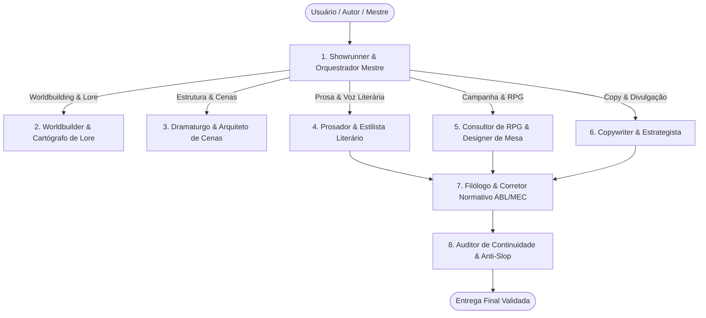

# Escritor Pro ✍️🇧🇷

> **Referência Arquitetural e Suíte de Escrita Criativa, Worldbuilding em 6 Camadas, Storytelling, Copywriting e Revisão Normativa PT-BR (MEC / ABL / VOLP)**

[](VERSION)
[]()
[]()
[]()

O **Escritor Pro** é uma skill projetada para atuar como o cérebro literário e arquitetural de autores, roteiristas, mestres de RPG e criadores de conteúdo. Ele resolve o clássico problema da *"doença do worldbuilder"* (paralisia por criação de lore infinito) e da mediocridade sintética de IA (*AI slop*), dividindo o trabalho entre **8 Sub-agentes Especializados** que compartilham uma **Fonte Única da Verdade (Single Source of Truth)**.

---

## 🏛️ Os 8 Sub-agentes Virtuais Especializados



1. **Showrunner / Orquestrador Mestre**: Conduz a entrevista investigativa cirúrgica (estilo `grill-me`), acolhe neurodivergentes (`not-today-adhd`) e roteia as demandas.
2. **Worldbuilder & Cartógrafo de Lore**: Domina o Método das 6 Camadas e as Leis de Sanderson sobre custos e limitações de poder.
3. **Dramaturgo & Arquiteto de Cenas**: Estrutura as batidas dramáticas (Cena & Sequela de Swain/Bickham, Dan Harmon, Save the Cat, Kishōtenketsu).
4. **Prosador & Estilista Literário**: Prosa imersiva, visceral e pautada no *Show, Don't Tell*, sem afetação mecânica.
5. **Consultor de RPG & Designer de Mesa (Lente B)**: Gera rumores (2V, 1F), relógios de ameaça, ganchos e blocos para Foundry VTT.
6. **Copywriter & Estrategista de Conteúdo**: Converte capítulos em sinopses, headlines magnéticas (Fórmula dos 4Us), campanhas e matriz de reaproveitamento 1 ➔ 7.
7. **Filólogo & Corretor Normativo (MEC / ABL / VOLP)**: Aplica o rigor gramatical sem achismo. Domina travessões verdadeiros (`—`), verbos *dicendi*, regência verbal estrita e o Novo Acordo Ortográfico.
8. **Auditor de Continuidade & Anti-Slop**: Caça inconsistências temporais e expurga implacavelmente os clichês artificiais de inteligência artificial.

---

## 🌍 As 6 Camadas Progressivas de Worldbuilding

Em vez de enciclopédias que atrasam a escrita, o mundo é construído em 6 camadas progressivas sob a **Regra do Iceberg Narrativo (10/90)**:

| Camada | Escopo | Foco Principal |
| :---: | :--- | :--- |
| **1** | **O DNA do Mundo** | Premissa em 1 linha, metafísica e Leis de Sanderson (o custo do poder). |
| **2** | **O Divino e o Folclore** | Deuses tangíveis ou distantes, lendas populares e tabus sagrados. |
| **3** | **Geografia e Recursos** | Clima hostil, barreiras físicas e o recurso escasso que motiva guerras. |
| **4** | **História Viva e Cicatrizes** | A última grande guerra, relíquias inexplicadas e ódios herdados. |
| **5** | **Geopolítica e Facções** | Tríade de cada facção (*o que quer*, *o que teme*, *o que controla*). |
| **6** | **O Nível da Rua** | Arquitetura, cheiros dominantes, segregação urbana e boatos de esquina. |

> **O Filtro Sensorial (Regra 3 + 1)**: Toda descrição de ambiente deve acionar pelo menos **3 estímulos sensoriais** (Visão + Audição + Olfato/Tato) e **1 tensão social ou econômica ativa**.

---

## 🪟 As Três Lentes de Saída (Single Source of Truth)

Tudo que é criado é armazenado em arquivos Markdown canônicos (`mundo/*.md`). Na hora de renderizar, escolhe-se a lente:

- **Modo Literário (`--modo livro`)**: Prosa fluida, subtexto psicológico, sem termos de regras ou metalinguagem de dados.
- **Modo Campanha / RPG (`--modo rpg`)**: Ganchos imediatos, 3 rumores (2 verdadeiros, 1 falso), relógios de perigo e compatibilidade com VTTs.
- **Modo Híbrido / Transmídia (`--modo ambos`)**: Texto de ambientação em prosa para leitura em voz alta acompanhado de apêndice técnico recolhido.

---

## 🧩 Enigmas, Quebra-Cabeças & Desafios Mentais

A suíte conta com um motor completo de design de desafios para livros e mesas de RPG:
- **A Regra das Três Pistas**: Toda resolução crítica conta com no mínimo três pistas independentes (óbvia, investigativa e sensorial).
- **Princípio do Fail Forward**: Falhas dos jogadores/protagonistas nunca geram paralisia estática; geram complicações dinâmicas ativas.
- **Cinco Tipos Dominados**:
  1. *Linguísticos & Criptográficos*: Cifras temáticas, anagramas de divindades e charadas em versos metrificados.
  2. *Mecânicos & Físicos*: Balanças de oferendas conceituais, vasos comunicantes de fluidos e engrenagens solares/lunares.
  3. *Lógicos & Dedutivos*: Matrizes de exclusão, testemunhos conflitantes e enigmas de falsários e sinceros.
  4. *Sensoriais & Sinestésicos*: Chamas de cores químicas, ressonâncias acústicas de sinos de quartzo e sombras ópticas.
  5. *Morais & Sacrifícios*: Desafios baseados nas Leis de Sanderson com preços reais para abrir passagens ancestrais.

---

## 📐 Gramática e Pontuação Oficial de Diálogos PT-BR

O **Escritor Pro** elimina o vício de traduções automáticas:
- ✅ **Travessão Verdadeiro**: Usa exclusivamente `—` (`\u2014`), nunca hífen `-` ou traço médio `–`.
- ✅ **Verbo Dicendi (Declarativo)**: Mantém vírgula na fala e verbo em minúscula:
  `— Não temos muito tempo — sussurrou Laura.`
- ✅ **Verbo de Ação**: Ponto final na fala e oração do narrador em MAIÚSCULA:
  `— O caminho está livre. — O batedor guardou a lâmina e correu.`

---

## 🛠️ Scripts Utilitários Inclusos

A skill acompanha três ferramentas em Python (compatíveis com Python 3.10 a 3.14+):

1. **`analisador_estilo.py`**:
   Analisa arquivos ou textos, detecta erros de travessão em diálogos, caça slop de IA da lista negra e avalia a densidade sensorial da cena.
   ```bash
   python scripts/analisador_estilo.py manuscrito.md
   ```

2. **`consulta_lexico.py`**:
   Consulta rápida à base de regência verbal canônica oficial (MEC/ABL), regras do Novo Acordo Ortográfico e dicionários abertos.
   ```bash
   python scripts/consulta_lexico.py assistir --regencia
   ```

3. **`validador_biblia.py`**:
   Valida se as entidades do mundo criadas em `mundo/` respeitam a Regra 3+1 e os metadados necessários.
   ```bash
   python scripts/validador_biblia.py mundo/
   ```

---

## 🔗 Integração com o Ecossistema de Skills

- **`grill-me`**: Entrevista inicial em 3 a 5 perguntas cirúrgicas para definir o projeto sem esforço mental excessivo.
- **`not-today-adhd`**: Proteção contra sobrecarga cognitiva para autores neurodivergentes.
- **`second-brain-plus`**: Persistência canônica do mundo na pasta `.second-brain/`.
- **`book-formatter` / `docs-for-markdown`**: Conversão de manuscritos, PDFs e materiais legados em Markdown estruturado.
- **`humanizer-plus`**: Descontaminação de caracteres invisíveis e marcas d'água de modelos de linguagem.
- **`image-to-prompt`**: Síntese de prompts para concept arts e ilustrações de capa.

---

## 📄 Licença

Distribuído sob a licença MIT. Parte integrante do ecossistema de skills avançadas para agentes de inteligência artificial.
