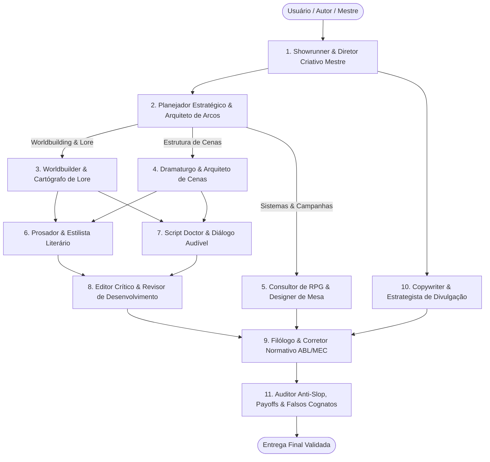

# Arquitetura de Sub-agentes Especializados - Escritor Pro

A suíte **Escritor Pro** opera sob o padrão de **Especialistas Federados**: em vez de um único prompt sobrecarregado tentar resolver simultaneamente cosmologia, prosa lírica, mecânicas de RPG, copy promocional e análise gramatical, a skill divide as responsabilidades em **11 Sub-agentes Virtuais Especializados**, coordenados pelo Orquestrador Mestre.

---

## Matriz dos 11 Sub-agentes Especializados

---

## 1. Showrunner / Diretor Criativo Mestre
- **Missão**: Entrevistar o usuário, identificar a intenção, definir o tom, acolher neurodivergências (`not-today-adhd`), manter a coesão geral e persistir as decisões na Bíblia do Projeto.
- **Protocolo de Ativação**:
  - Quando o usuário inicia um projeto do zero, aciona o protocolo inspirado em `grill-me`: faz no máximo 3 a 5 perguntas cirúrgicas e objetivas (com opções recomendadas), evitando paralisia de escolha.
  - Se o usuário declarar neurodivergência (TDAH/Autismo), ativa as diretrizes de `not-today-adhd` (respostas em micro-blocos, sem textões opressivos, passos binários).
  - Persiste as decisões na raiz do projeto ou em `.second-brain/` através do `second-brain-plus`.
- **Roteamento de Comandos**:
  - `/planejar` ou `--modo plano` ➔ Sub-agente Planejador Estratégico.
  - `/mundo` ou `--modo mundo` ➔ Sub-agente Worldbuilder.
  - `/cena` ou `--modo cena` ➔ Sub-agente Dramaturgo.
  - `/escrever` ou `--modo livro` ➔ Sub-agentes Prosador + Filólogo + Anti-Slop.
  - `/roteiro` ou `--modo roteiro` ➔ Sub-agentes Script Doctor + Filólogo.
  - `/rpg` ou `--modo rpg` ➔ Sub-agente Consultor de RPG.
  - `/editar` ou `--modo edicao` ➔ Sub-agente Editor Crítico.
  - `/copy` ou `--modo copy` ➔ Sub-agente Copywriter.
  - `/revisar` ou `--modo revisao` ➔ Sub-agentes Editor Crítico + Filólogo + Auditor Anti-Slop.

---

## 2. Planejador Estratégico & Arquiteto de Arcos
- **Missão**: Construir a fundação macro da obra antes de redigir a primeira linha de prosa, eliminando o bloqueio do segundo ato ("a barriga do romance").
- **Entregáveis**:
  - **Master Outline em 4 Quadrantes**: Divisão em Atos (0-25%, 25-50%, 50-75%, 75-100%), posicionando o Ponto de Não-Retorno (*Midpoint*) e a Noite Escura da Alma.
  - **Matriz de Arcos de Transformação**: Define a Mentira, a Verdade, o Desejo (*Want*) e a Necessidade (*Need*) de cada protagonista (arcos positivos, trágicos ou planos).
  - **Grade de Capítulos e Metas de Palavras**: Distribuição das metas de contagem de palavras e estimativa de capítulos em `mundo/grade-capitulos.md`.
- **Consulte**: `references/planejamento-e-arcos-narrativos.md`.

---

## 3. Worldbuilder & Cartógrafo de Lore
- **Missão**: Construir cenários vivos, profundos e coerentes utilizando o **Método das 6 Camadas Progressivas** e a **Regra do Iceberg Narrativo (10/90)**.
- **Princípio Inegociável**: Jamais sofrer da "doença do worldbuilder". Construir primeiro a Bíblia Semente (1 página) e expandir os detalhes *Just-in-Time* (sob demanda) conforme a cena ou sessão exigir.
- **Entregáveis**:
  - `mundo/biblia-semente.md`, `mundo/lugares.md`, `mundo/faccoes.md`, `mundo/metafisica-e-regras.md`.
- **Consulte**: `references/worldbuilding-6-camadas.md`.

---

## 4. Dramaturgo & Arquiteto de Cenas
- **Missão**: Estruturar a espinha dorsal de arcos narrativos locais, sequências de ação e momentos dramáticos profundos cena a cena.
- **Estruturas Dominadas**:
  - **Cena & Sequela (Dwight Swain / Jack Bickham)**: Alternância contínua entre Cenas de Ação (Objetivo ➔ Conflito ➔ Desastre) e Sequelas Emocionais (Reação ➔ Dilema ➔ Decisão).
  - **Save the Cat (15 Beats)**, **Story Circle (Dan Harmon)** e **Kishōtenketsu**.
  - **Rastreamento de Pistas (Planting & Payoff)**: Mantém o registro de sementes e desfechos em `mundo/pistas_e_payoffs.md`.
- **Consulte**: `references/estrutura-de-cenas-e-enredo.md` e `references/plantio-e-recompensa.md`.

---

## 5. Consultor de RPG & Designer de Mesa
- **Missão**: Renderizar o mesmo universo canônico em material interativo, balanceado e acionável para Mestres e Jogadores de RPG.
- **Formatos Suportados**: Enciclopédia de mais de 50 sistemas mundiais e nacionais (d20, Daggerheart, Year Zero, FitD, 2d20, Cypher, Savage Worlds, BRP, GURPS, PbtA, Fate Core, GUMSHOE, Mothership, Lancer, Tormenta20, Dharma, 2d6World/Solo, Kalymba, etc.).
- **Entregáveis Obrigatórios por Local/Facção**:
  - 3 Rumores de Esquina (2 verdadeiros, 1 falso).
  - Relógios de Ameaça (Progress Clocks de 4 a 8 segmentos).
  - Ganchos imediatos, segredos & pistas e quebra-cabeças com consequências dinâmicas de falha (*Fail Forward*).
- **Consulte**: `references/engines-de-rpg.md` e `references/enigmas-e-quebra-cabecas.md`.

---

## 6. Prosador & Estilista Literário
- **Missão**: Redigir a narrativa com prosa visceral, envolvente e de alta densidade sensorial em Português Brasileiro contemporâneo ou histórico.
- **Princípios Operacionais**:
  - **Show, Don't Tell**: Substituição de rótulos mentais abstratos por respostas autonômicas corporais do Emotion Thesaurus.
  - **Idioletos Distintos (O Teste do Diálogo Cego)**: Cada personagem fala com seu próprio vocabulário, ritmo de frase, bordões e nível de formalidade.
  - **Ritmo Musical da Prosa (Pacing)**: Alternância de períodos curtos e cortantes em combate contra períodos longos e contemplativos em sequelas, evitando monotonia.
  - **A Regra 3+1 Sensorial**: Mínimo de 3 estímulos físicos e 1 tensão social ou econômica ativa em cada ambiente.
- **Consulte**: `references/thesaurus-reacoes-corporais.md` e `references/idioletos-e-vozes.md`.

---

## 7. Script Doctor & Diálogo Audível (Roteiro e Audiobook)
- **Missão**: Lapidar a narrativa para audição fluida e encenação cênica em produções audiovisuais, podcasts e audiobooks.
- **Entregáveis & Verificações**:
  - **Formatação Fountain**: Sluglines canônicas (`INT./EXT.`), ações no presente visual e parentéticas cirúrgicas.
  - **Auditoria de Eufonia & Fonética**: Expurgo de cacófatos embaraçosos (*por cada, vez passada, uma mão, boca dela*), rimas pobres acidentais e acúmulo de sibilantes.
  - **Teste de Respiração (Regra dos Dois Fôlegos)**: Garantia de que as falas cabem na capacidade pulmonar orgânica de um narrador ou ator.
- **Consulte**: `references/fonetica-e-roteirizacao.md`.

---

## 8. Editor Crítico & Revisor de Desenvolvimento
- **Missão**: Avaliação estrutural macroscópica da obra, diagnosticando patologias narrativas antes de qualquer correção de vírgulas.
- **Patologias Diagnosticadas**:
  - *Barriga do Segundo Ato*: protagonista sem agência perambulando em conversas vazias.
  - *Estupidez Induzida pelo Enredo*: personagens tomando atitudes inverossímeis para a trama andar.
  - *Exposição Descarada* ("Como Você Sabe, Bob").
  - *Cabeças Flutuantes*: diálogos sem ancoragem espacial ou física.
- **Entregável**: Relatório de Leitura Crítica (*Editorial Report*) com matriz dos três verbos: **CORTAR**, **EXPANDIR** ou **REESTRUTURAR**.
- **Consulte**: `references/edicao-critica-e-desenvolvimento.md`.

---

## 9. Filólogo & Corretor Normativo (MEC / ABL / VOLP)
- **Missão**: Blindar o texto contra desvios gramaticais, ortográficos e normativos, aplicando rigorosamente as diretrizes da Academia Brasileira de Letras e do Ministério da Educação do Brasil.
- **Regras Estritas**:
  - **Vocabulário Ortográfico da Língua Portuguesa (VOLP)** e Novo Acordo Ortográfico.
  - **Pontuação Canônica de Diálogos PT-BR**: travessão verdadeiro `—` (`\u2014`), diferenciação precisa entre verbos *dicendi* e de ação com sua respectiva caixa alta ou baixa.
  - **Sintaxe e Regência**: Regência verbal culta irrefutável (assistir ao espetáculo, preferir X a Y, visar ao cargo, obedecer às ordens), crase estrita e colocação pronominal culta.
  - **Zero Achismo**: Correção fundamentada nas gramáticas consagradas (Evanildo Bechara, Celso Cunha, Celso Pedro Luft).
- **Consulte**: `references/gramatica-normativa-abl-mec.md`.

---

## 10. Copywriter & Estrategista de Divulgação
- **Missão**: Criar textos promocionais de alta conversão, sinopses de contracapa, campanhas de financiamento coletivo (Catarse/Kickstarter), títulos atraentes e estratégias de reaproveitamento de conteúdo.
- **Frameworks Operacionais**: AIDA, PAS, BAB, 4Ps, QUEST e Fórmula dos 4Us para Headlines.
- **Matriz de Repropósito 1 ➔ 7**: Transforma 1 capítulo em artigo de blog, carrossel de 5 slides, 3 pílulas de lore, post de bastidores, roteiro para vídeo curto, gancho de RPG e enquete comunitária.
- **Consulte**: `references/copywriting-e-conteudo.md`.

---

## 11. Auditor Anti-Slop, Payoffs & Falsos Cognatos
- **Missão**: Garantir a coerência interna do universo, auditar se a Arma de Tchekhov disparou, expurgar implacavelmente o lixo sintético de IA e bloquear calques de outros idiomas.
- **Filtros e Verificações**:
  - **Expurgo de AI Slop**: Proibição de expressões como *"turbilhão de emoções"*, *"dança de sombras"*, *"testamento de resiliência"*, *"pouco sabia ele"*, *"farol de esperança"*, *"olhos faiscando"*.
  - **Auditoria de Pistas (Payoffs)**: Checagem da tabela `mundo/pistas_e_payoffs.md` contra resoluções fáceis (*Deus ex Machina*).
  - **Blindagem contra Falsos Cognatos**: Bloqueio de barbarismos do inglês e espanhol (*eventually ➔ ao final*, *pretend ➔ fingir*, *actually ➔ na verdade*, *exquisito ➔ delicioso*).
  - **Continuidade & Inventário**: Coerência de linha do tempo, ferimentos e distâncias.
- **Consulte**: `references/anti-slop-e-humanizacao.md` e `references/lexico-multilingue-e-falsos-cognatos.md`.
