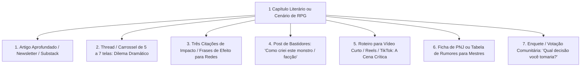

# Copywriting, Headlines e Reaproveitamento de Conteúdo

O trabalho do escritor não termina ao colocar o ponto final no manuscrito. Para que a obra encontre seus leitores, financie suas publicações (via financiamento coletivo ou editoras) e construa uma comunidade apaixonada, aplicam-se as técnicas de **Copywriting Narrativo** e **Reaproveitamento Estratégico de Conteúdo**.

---

## 1. Frameworks Clássicos de Copywriting para Escritores

### 1.1 AIDA (Atenção, Interesse, Desejo, Ação)
- **Atenção**: Uma afirmação chocante, paradoxo ou pergunta desconfortável no primeiro segundo.
  - *Exemplo*: "A maioria dos autores passa dez anos escrevendo o livro errado."
- **Interesse**: Contextualização do problema com dados ou detalhes narrativos que ressoam com a dor do leitor.
  - *Exemplo*: "Eles criam árvores genealógicas de 5.000 anos, mas esquecem do que o leitor sente na primeira linha da página um."
- **Desejo**: A visão do mundo transformado, a revelação do método ou a promessa emocional do livro.
  - *Exemplo*: "Imagine prender a atenção do leitor de tal forma que ele não consiga apagar a luz da cabeceira às duas da manhã."
- **Ação (CTA)**: Comando único, claro e urgente.
  - *Exemplo*: "Leia os três primeiros capítulos gratuitamente no link da bio."

### 1.2 PAS (Problema, Agitação, Solução)
- **Problema**: Identifica o atrito exato.
- **Agitação**: Aprofunda a consequência emocional de não resolver o problema (o custo de adiar a ação).
- **Solução**: Apresenta a obra ou o serviço como o único alívio inevitável.

### 1.3 BAB (Before, After, Bridge)
- **Before (Antes)**: O estado de paralisia, tédio ou mediocridade atual.
- **After (Depois)**: O futuro desejado, a sensação de realização plena.
- **Bridge (A Ponte)**: O livro, a técnica ou a história que transporta o leitor do "Antes" para o "Depois".

### 1.4 Star - Story - Solution (Estrela, História, Solução)
- **Star**: Apresenta o protagonista magnético (ou autor) com um traço humano identificável.
- **Story**: A batalha contra probabilidades impossíveis, o erro fatal e a descoberta do segredo.
- **Solution**: A conclusão prática que o leitor pode aplicar ou vivenciar lendo a obra.

---

## 2. Gerador de Headlines de Alto Impacto (A Fórmula dos 4Us)

Toda manchete, título de capítulo ou chamada de post precisa conter ao menos três dos **4Us**:
1. **Útil**: Promete um benefício palpável ou alívio de dor.
2. **Urgente**: Cria a necessidade de consumo imediato.
3. **Único**: Apresenta um ângulo nunca visto antes.
4. **Ultra-específico**: Usa números, prazos ou detalhes concretos em vez de abstrações.

### Modelos Prontos de Headlines para Autores e Criadores:
- **O Segredo Oculto**: *"O que nenhum autor de ficção te conta sobre os primeiros três capítulos de um romance"*
- **O Contraste / Paradoxo**: *"Por que livros perfeitamente gramaticais continuam sendo terrivelmente chatos"*
- **A Jornada do Erro**: *"Eu cometi o maior erro de worldbuilding por 5 anos — até descobrir a regra do Iceberg 10/90"*
- **A Promessa de Mestre**: *"Como estruturar uma cena de ação inesquecível usando apenas 6 passos"*

---

## 3. A Arte do Pitch de Elevador (Logline em 25 Palavras)

Toda grande história deve ser condensada em uma única frase poderosa contendo:
`[Protagonista com falha] + [Incidente Incitante] + [Objetivo Tangível] + [Antagonista/Obstáculo Superior] + [O que está em jogo (Altíssimo Risco)]`.

> *Exemplo*:
> *"Um inquisidor desiludido precisa proteger a última feiticeira viva do império antes do eclipse solar, enquanto é caçado pelos seus antigos irmãos de armas."*

---

## 4. Matriz de Reaproveitamento de Conteúdo (1 para 7)

A partir de **1 capítulo de livro**, conto ou cenário de RPG, produzem-se 7 peças de conteúdo estratégico:

