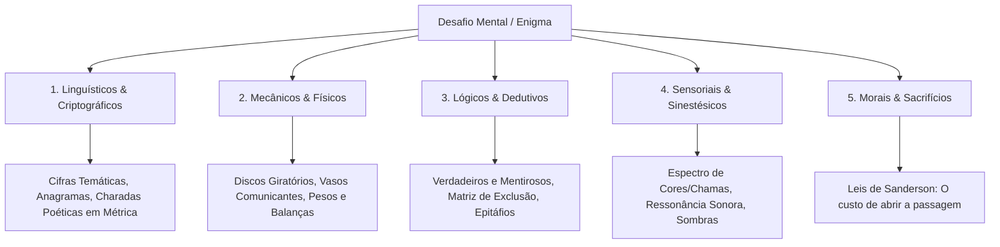

# Enigmas, Quebra-Cabeças e Desafios Mentais (Puzzles & Riddles)

Um grande enigma ficcional ou quebra-cabeça de RPG não serve apenas para testar a inteligência do jogador ou leitor; ele serve para **aprofundar o lore, elevar a tensão dramática e recompensar a atenção aos detalhes**.

O maior pecado no design de enigmas é a **"Lógica da Lua" (*Moon Logic*)** — desafios cuja solução só faz sentido na cabeça do autor, gerando frustração e paralisia narrativa. Para evitar isso, o **Escritor Pro** adota princípios rigorosos de arquitetura de quebra-cabeças.

---

## 1. As Quatro Leis Fundamentais dos Quebra-Cabeças

1. **A Regra das Três Pistas (Justin Alexander)**:
   - Para qualquer conclusão necessária para avançar a história, deve haver **no mínimo 3 pistas independentes** disponíveis no ambiente.
   - *Pista A (Óbvia)*: O epitáfio esculpido no portal de pedra.
   - *Pista B (Investigativa)*: O diário rasgado encontrado no corpo do explorador anterior.
   - *Pista C (Sensorial/Ambiental)*: A direção do vento que apaga tochas específicas ou as marcas de arranhão no piso de calcário.
2. **Princípio do *Fail Forward* (Falhar para a Frente)**:
   - O erro nunca deve gerar um beco sem saída estático ("você errou, nada acontece").
   - O erro deve gerar uma **consequência dinâmica que altera a situação**: um alarme dispara, o nível da água sobe, uma estátua protetora ganha vida ou uma passagem alternativa e mais perigosa é destravada.
3. **Diegese Obrigatória (O Enigma Pertence ao Mundo)**:
   - O quebra-cabeça não foi colocado ali por um "mestre de jogo sádico"; ele foi construído por uma facção, clérigo ou tirano com um **propósito histórico concreto** (proteger relíquias de infiéis, testar a devoção de noviços, servir de cofre mecânico ou preservar segredos de família).
4. **Resolução em Múltiplas Camadas**:
   - Uma solução direta (quebra intelectual pura).
   - Uma solução empírica/lateral (força bruta, sabotagem do mecanismo ou sacrifício de recursos).
   - Uma solução social (negociar com o espírito do construtor ou subornar quem conhece o segredo).

---

## 2. Taxonomia dos Tipos de Enigmas

---

### Tipo 1: Enigmas Linguísticos e Criptográficos
Ideais para bibliotecas proibidas, tumbas de poetas, cartas interceptadas e cultos herméticos:
- **Charadas Poéticas com Duplo Sentido**:
  - Construídas em quartetos rimados ou redondilhas maiores (sete sílabas poéticas), utilizando metáforas materiais do próprio cenário.
  - *Exemplo de Charada Diegética*:
    > *"Nasço no seio da forja sem ter fogo no ventre,*  
    > *Cresço na boca do poço onde a corda me beija,*  
    > *Quando me quebram, o homem se torna inocente,*  
    > *Quando me forjam, sou o grito que a corte deseja."*  
    > ➔ **Resposta**: **A Corrente / O Grilhão**.
- **Cifras de Deslocamento Temático**: Em vez de cifras aleatórias de computador, o deslocamento alfabético baseia-se em um fato histórico canônico (ex: *a chave é o número de imperadores assassinados durante a Noite das Máscaras: 7*).
- **Anagramas Sagrados**: Nomes de deuses ou tiranos cujas letras rearranjadas formam o comando que desativa as defesas mecânicas.

---

### Tipo 2: Quebra-Cabeças Mecânicos e Físicos
Perfeitos para ruínas anãs, masmorras de engenharia, laboratórios arcanos e cofres de guildas:
- **A Balança dos Valores Opostos**:
  - Uma balança de bronze diante de uma estátua de julgamento. Para destravar a porta, os dois pratos não devem conter pesos iguais de metal, mas itens simbólicos correspondentes ao mito fundador da ordem (ex: *em um prato, cinzas do braseiro sagrado; no outro, uma gota de sangue fresco do líder*).
- **Vasos Comunicantes e Dinâmica de Fluidos**:
  - Três reservatórios de mercúrio ou óleo com capacidades distintas (ex: 8 litros, 5 litros e 3 litros). O mecanismo da comporta só é acionado quando um dos reservatórios contiver exatamente 4 litros, forçando o cálculo de transvasamento.
- **Relógios e Alinhamento de Engrenagens Zodiacais**:
  - Discos de pedra concêntricos que precisam ser alinhados de acordo com a posição dos planetas ou as fases das duas luas do cenário na data em que a tumba foi lacrada.

---

### Tipo 3: Enigmas Lógicos e Dedutivos
Desafios onde a resposta é deduzida eliminando contradições a partir de testemunhos fragmentados:
- **O Banquete dos Falsários (Lógica de Exclusão)**:
  - Cinco taças de cristal diante de cinco esqueletos vestidos com librés nobres. Cada um segura um bilhete que contém uma declaração sobre quem envenenou quem:
    - *O Barão diz: "O veneno está na taça de rubi ou na de esmeralda."*
    - *A Duquesa diz: "A taça do Duque é segura para beber."*
    - *O Bispo diz: "Eu nunca bebi em taça de ouro."*
    - *O Mestre das Moedas diz: "Dois de nós estão mentindo e três dizem a verdade."*
  - Os jogadores/personagens devem cruzar as declarações para identificar a única taça livre de cicuta.
- **O Teste das Quatro Portas de Elementos**:
  - Quatro portais com inscrições elementais (Fogo, Sal, Cinzas, Vento), onde cada porta declara qual das outras conduz à morte imediata.

---

### Tipo 4: Quebra-Cabeças Sensoriais e Sinestésicos
Desafios que exploram percepção física, som, espectro de luz e tato:
- **A Harmonia dos Sinos de Quartzo (Acústico)**:
  - Uma câmara octogonal com sinos de cristal de tamanhos variados. Bater nos sinos na ordem incorreta gera um choque sonoro atordoante; a ordem correta corresponde à canção de ninar que os camponeses cantam no primeiro capítulo da história.
- **O Espectro da Tocha Alquímica (Cromático)**:
  - Paredes com murais invisíveis pintados com pós minerais especiais. Apenas quando iluminadas por chamas de sais específicos (fogo verde de cobre, fogo púrpura de potássio, fogo amarelo de sódio) as palavras secretas são reveladas.
- **A Sombra do Solstício (Projeção Óptica)**:
  - Uma lente talhada em diamante precisa ser posicionada de modo que o feixe de luar atravesse o olho de uma gárgula e aponte para a laje oca no piso.

---

### Tipo 5: Enigmas Morais e Sacrifícios (Custo de Sanderson)
O enigma cuja chave não é apenas lógica, mas ética e pessoal:
- **A Porta que Sangra a Virtude**:
  - A porta de um santuário ancestral não exige chave; ela possui uma reentrância em formato de mão cravada de espinhos de obsidiana. Para abri-la, alguém precisa doar voluntariamente vitalidade (reduzindo temporariamente atributos ou aceitando uma cicatriz indelével).
- **O Dilema dos Dois Prisioneiros**:
  - Duas alavancas em lados opostos de um abismo. Abaixar uma alavanca salva a vida de um aliado, mas condena os arquivos da biblioteca ancestral à destruição pelo fogo.

---

## 3. Matriz de Criação de Enigmas em 4 Etapas

Quando o usuário pedir a geração de um quebra-cabeça, a skill segue o fluxo estruturado:

| Etapa | Pergunta de Design | Decisão Prática |
| :--- | :--- | :--- |
| **1. Objetivo Diegético** | Por que isso existe aqui e quem construiu? | Proteção contra saqueadores / Teste de lealdade da guilda. |
| **2. A Chave Canônica** | Qual elemento do lore responde ao desafio? | O tratado que encerrou a Guerra dos Três Ducados. |
| **3. A Estrutura das 3 Pistas** | Como os personagens descobrem a solução? | Um verso no vitral + Uma data no anel do defunto + O número de arcos da sala. |
| **4. O Desfecho de Falha** | O que acontece no erro? (*Fail Forward*) | O chão inclina 15 graus e escorpiões mecânicos saem das frestas. |

---

## 4. Renderização nas Diferentes Lentes

### Na Lente Literária (`--modo livro`)
- O enigma é dramatizado através da psicologia das personagens:
  - Mostre a frustração, o suor na testa, o desespero do tempo esgotando (as tochas queimando até o fim).
  - Use o quebra-cabeça para revelar atritos na equipe (quem perde a paciência primeiro, quem enxerga a solução lateral, quem quase comete o erro fatal).
  - **Show, Don't Tell**: Descreva o barulho de trincas de pedra, o cheiro de ozônio de um mecanismo arcano armado e a tensão nas pontas dos dedos ao girar um disco pesado.

### Na Lente de RPG / Mesa (`--modo rpg`)
- A entrega contém:
  - **Texto de Descrição para Leitura em Voz Alta (Read-Aloud)**.
  - **Handout Transcrito**: O texto exato da charada ou pista para copiar e colar para os jogadores.
  - **Caixa de Segredo do Mestre (Spoiler / Gabarito)**: A explicação mecânica da solução.
  - **Tabela de Testes de Percepção / Investigação Alternativos**: O que um personagem treinado descobre para obter dicas graduais (sem entregar a resposta de graça).
  - **Estatísticas da Consequência de Falha**: Dano, armadilha, iniciativa de monstros ou contagem regressiva no Relógio de Ameaça.
