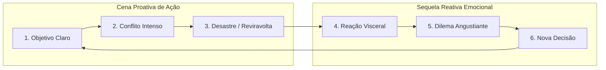

# Estrutura de Cenas, Enredo e Storytelling

Uma história não é apenas uma sucessão aleatória de eventos ("isso aconteceu, e então aquilo aconteceu"); uma história viva é regida pelo princípio causal de **"portanto / por causa disso"** ou **"mas / no entanto"**.

---

## 1. A Arquitetura da Cena: O Ciclo Cena & Sequela

Formulado por Dwight Swain e Jack Bickham, o modelo **Cena & Sequela** é a engrenagem fundamental da ficção de ritmo implacável.

### 1.1 A Cena (Modo Ação)
1. **Objetivo (Goal)**: A personagem quer algo específico, urgente e tangível no início da cena (ex: *arrombar a escotilha antes que a câmara inunde*).
2. **Conflito (Conflict)**: Uma força opositora consciente, física ou ambiental bloqueia o objetivo a cada passo (ex: *a tranca está enferrujada e um vigia se aproxima*).
3. **Desastre (Disaster)**: O desfecho da cena responde ao objetivo com uma das três respostas dramáticas:
   - *Não* (Fracasso direto).
   - *Sim, mas...* (Consegue o que queria, porém gera um problema ainda pior).
   - *Não, e além do mais...* (Falha catastroficamente e perde um recurso vital).

### 1.2 A Sequela (Modo Reflexão / Pós-Choque)
1. **Reação (Reaction)**: O impacto fisiológico e emocional imediato do desastre (dor, choque, raiva, colapso físico).
2. **Dilema (Dilemma)**: Diante do desastre, a personagem não tem opções fáceis; todas as saídas cobram um preço amargo (ex: *abandonar o ferido ou ser capturado junto com ele*).
3. **Decisão (Decision)**: A personagem escolhe a menos pior das alternativas e traça um novo plano, que se converte no **Objetivo** da próxima cena.

---

## 2. As Grandes Estruturas de Enredo

### 2.1 O Story Circle de Dan Harmon (O Círculo da Mudança)
Ideal para romances e arcos de episódios/capítulos:
1. **Zona de Conforto**: A personagem em seu mundo cotidiano.
2. **Necessidade / Desejo**: Algo está incompleto ou uma perturbação externa exige ação.
3. **Território Desconhecido**: A personagem cruza o limiar para um ambiente estranho.
4. **Adaptação**: Enfrenta provas, testes e adquire novos aliados ou ferramentas.
5. **Conquista**: Encontra o que buscava avidamente (o falso triunfo ou revelação).
6. **Preço Pago**: Sofre uma perda pesada ou sacrifício necessário pelo prêmio.
7. **Retorno**: Volta ao seu mundo ou status quo inicial.
8. **Transformação**: O mundo é o mesmo, mas a personagem mudou irrevogavelmente.

### 2.2 Beat Sheet Save the Cat! (Blake Snyder)
Adaptado para literatura em 15 batidas dramáticas:
1. **Imagem Inicial**: O estado de espírito do protagonista antes da mudança.
2. **Declaração do Tema**: Uma fala ou evento sutil que resume a lição moral da história.
3. **Configuração (Setup)**: O mundo cotidiano, suas falhas e o que está em jogo.
4. **Catalisador**: O incidente incitante que destrói o equilíbrio (a carta chega, o assassinato ocorre).
5. **Debate**: A hesitação em agir ("Não posso fazer isso").
6. **Entrada no Ato 2**: A decisão sem volta de aceitar a jornada.
7. **História B**: Introdução da relação emocional/mentor/romance que espelha o tema.
8. **Jogos e Brincadeiras (Fun and Games)**: A promessa da premissa sendo entregue (o detetive investigando, o mago aprendendo feitiços).
9. **Ponto Central (Midpoint)**: Falsa vitória ou falsa derrota; os riscos sobem de patamar.
10. **Os Vilões se Fecham**: As forças antagônicas revidam com ferocidade redobrada.
11. **Tudo Está Perdido (All Hope is Lost)**: O ponto mais baixo do protagonista; a morte simbólica de algo querido.
12. **Noite Escura da Alma**: A depressão e reflexão antes da centelha final de iluminação.
13. **Entrada no Ato 3**: A nova ideia que une a lição temática com a solução prática.
14. **Final (Clímax)**: Confronto final em 5 fases (reunir a equipe, execução do plano, surpresa do vilão, novo sacrifício, triunfo moral).
15. **Imagem Final**: O espelho da imagem inicial, demonstrando a metamorfose completa.

### 2.3 Curva Fichteana (Suspense, Horror e Thrillers)
Em vez de esperar o ponto central, a história atira o protagonista em uma sequência ininterrupta de crises em escala ascendente:
- **Exposição Rápida** ➔ **Crise 1** ➔ Pequeno respiro ➔ **Crise 2** ➔ Respiro ➔ **Crise 3 (Catastrófica)** ➔ **Clímax Definitivo** ➔ **Resolução Breve**.

### 2.4 Kishōtenketsu (Narrativa Oriental Sem Antagonismo Maniqueísta)
1. **Ki (Introdução)**: Apresentação de personagens e contexto.
2. **Shō (Desenvolvimento)**: Expansão do contexto sem grandes rupturas.
3. **Ten (Reviravolta / Desconexão)**: Introdução de um elemento aparentemente desconexo ou surpreendente que recontextualiza tudo.
4. **Ketsu (Conclusão)**: A união harmoniosa do contexto original com a reviravolta.

---

## 3. Data Storytelling: Narrativas Guiadas por Fatos e Evidências

Quando o objetivo é produzir não-ficção, relatórios corporativos, artigos investigativos ou histórias fundamentadas em pesquisas empíricas:
1. **O Gancho Humano (A Vítima ou Beneficiário)**: Comece nunca pela média estatística fria, mas pelo rosto de quem é impactado pelo número.
2. **O Gráfico em Prosa (Tensão Analítica)**: Apresente o conflito entre o que o senso comum espera e o que a métrica irrefutável revelou.
3. **O Clímax Analítico**: O ponto onde a correlação prova causalidade ou derruba um dogma estabelecido.
4. **Chamada à Transformação**: O plano acionável prescrito pelas evidências.
