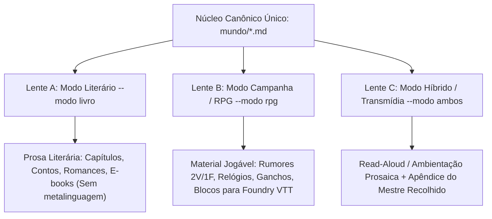

# Núcleo Canônico e as Três Lentes de Saída

Um mundo rico e crível serve como **Fonte Única da Verdade (Single Source of Truth)** tanto para a literatura quanto para mesas de RPG. O universo ficcional não muda; o que muda é **a lente de renderização** (o modo de saída).

---

## Arquitetura: Uma Fonte Canônica, Múltiplas Lentes



---

## 1. O Núcleo Canônico (A Base Compartilhada)

Armazenado em arquivos Markdown limpos (estilo Obsidian / Second Brain), cada entidade do mundo segue o padrão:

```markdown
---
tipo: lugar | faccao | personagem | reliquia | divindade
nome: "Nome da Entidade"
camada: 1..6
tags: [dark-fantasy, porto, corrupcao]
---

### Identidade & Conceito Central
[Definição clara em 1 a 2 linhas: o que é e qual o seu propósito no mundo.]

### Textura Sensorial & Atmosfera (Regra 3+1)
- **Visual**: [Detalhes visuais marcantes, luz, arquitetura, vestimentas]
- **Sonoro**: [Sons de fundo, ecos, sussurros, rangidos, silêncios tensos]
- **Olfativo/Tátil**: [Cheiros dominantes, umidade, textura sob os dedos]
- **Tensão Social Ativa**: [O atrito visível entre classes, facções ou credos]

### Conflito & Sangria
- **Quem lucra aqui**: [Facção, indivíduo ou casta privilegiada]
- **Quem sangra aqui**: [Oprimidos, trabalhadores, estrangeiros, vítimas]
- **O segredo podre**: [O que ninguém diz em voz alta, mas todos sabem]

### Vínculos & Conexões
- **Ligado a**: [[Fação-X]], [[Guerra-Y]], [[Personagem-Z]]
```

---

## 2. Lente A: Modo Literário (`--modo livro`)

Utilizado quando o objetivo é a escrita de romances, contos, novelas e roteiros:
- **Filosofia**: Foco absoluto em imersão, subtexto, fluxo psicológico e técnica do *Show, Don't Tell*.
- **Sem Ruídos Metalinguísticos**: Proibido incluir termos de jogo como "faça um teste de percepção", "CD 15", "vantagem/desvantagem" ou tabelas de dados. O mundo surge pelas sensações e ações dos personagens.
- **Linguagem**: Prosa lapidada em Português Brasileiro contemporâneo e elegante, ritmo frasal dosado de acordo com a tensão da cena.
- **Exemplo de Saída**:
  > *A chuva de outono descia ácida pelas telhas de ardósia das Docas Negras, lavando o sangue de enguia que empesteava as pedras do cais. Martim apertou o capuz encharcado contra a testa; o vento cortante trazia o baque surdo de martelos nas forjas do porto e o cheiro enjoativo de carvão molhado. Três garotos maltrapilhos, com os dedos azuis de frio, disputavam lascas de lenha úmida caídas das carroças dos mercadores, sob os olhos sonolentos de dois guardas imperiais com lanças enferrujadas.*

---

## 3. Lente B: Modo Campanha / RPG (`--modo rpg`)

Utilizado quando o objetivo é alimentar mesas de RPG (D&D, Pathfinder 2e, SWADE, Year Zero, Chamado de Cthulhu, Tormenta20) ou alimentar sistemas VTT (Foundry VTT, Gravewright):
- **Filosofia**: Agência dos jogadores, pontos de pressão, escolhas de risco vs. recompensa e ganchos imediatos.
- **Estrutura Obrigatória da Entrega**:
  1. **3 Rumores de Taverna / Esquina**:
     - *Rumor 1 (Verdadeiro)*: Informação precisa, mas perigosa.
     - *Rumor 2 (Verdadeiro)*: Revela fraqueza de uma facção ou tesouro esquecido.
     - *Rumor 3 (Falso ou Distorcido)*: Uma meia-verdade que conduz a uma emboscada ou mal-entendido.
  2. **Relógio de Ameaça (Progress Clock - 4 a 8 segmentos)**:
     - Qual desastre avança se os heróis não intervirem? (Ex: *4/6 - O culto termina o ritual do eclipse*).
  3. **3 Ganchos de Aventura Imediatos**:
     - Cada gancho com um contratante, uma complicação moral e uma recompensa prometida.
  4. **Segredos & Pistas Descobertas na Cena**:
     - Pistas que podem ser obtidas via investigação, suborno ou intimidação.
  5. **Integração com Foundry VTT**:
     - Formatação compatível com Journal Handouts, Rolltables e Actors prontos para cópia ou acionamento pelo MCP `master-of-foundryvtt`.

---

## 4. Lente C: Modo Híbrido / Transmídia (`--modo ambos`)

Perfeito para quem joga e escreve simultaneamente, ou prepara um romance acompanhado de suplemento de cenário:
- **Estrutura da Saída**:
  1. **Texto de Ambientação (Read-Aloud / Prosa Literária)**: 2 a 4 parágrafos imersivos, em itálico ou bloco de citação, ideais para abrir um capítulo literário ou serem lidos em voz alta na abertura de uma sessão de RPG.
  2. **Apêndice do Autor / Mestre (Recolhido em `<details>` ou Seção Estruturada)**:
     - Bastidores da cena.
     - Ficha de NPCs presentes com motivação, segredo e fraqueza.
     - Estatísticas simplificadas ou notas de direção dramática.
     - Rumores e ganchos complementares.
