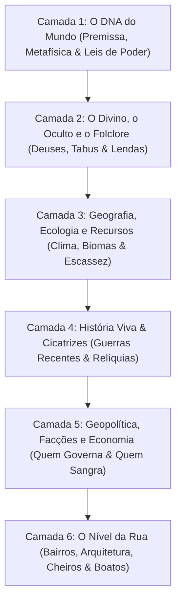

# Worldbuilding em 6 Camadas Progressivas & Iceberg Narrativo

Construir mundos memoráveis — seja para romances épicos, séries de ficção científica, contos sombrios ou campanhas de RPG — exige evitar a **"doença do worldbuilder"** (paralisia onde o autor passa anos detalhando genealogias e dinastias de 5.000 anos sem escrever a primeira cena).

A metodologia da **Escritor Pro** combina a visão **Macro (Top-Down)** para estabelecer leis invioláveis com a visão **Micro (Bottom-Up)** para entregar textura tátil, odor e conflito imediato.

---

## As 6 Camadas Progressivas



---

### Camada 1: O Conceito Central e as Regras da Realidade (O "DNA" do Mundo)
Antes de traçar rios ou nomear reis, defina o que torna a física e a existência deste mundo singulares:
- **Premissa e Tom em Uma Frase**: Qual é a fratura fundamental deste universo?
  - *Exemplo*: "Um império costeiro onde os mortos não apodrecem, transformando-se em salitre que alimenta a pólvora da corte."
- **Cosmologia e Metafísica**: Como o cosmos opera? O tempo é linear, espiral ou entrópico? As almas reencarnam, dissipam-se no éter ou são devoradas por entidades astrais?
- **Sistemas de Poder / Tecnologia (Leis de Sanderson)**:
  1. *Primeira Lei*: A habilidade do autor de resolver conflitos com mágica/tecnologia é diretamente proporcional a quão bem o leitor compreende suas regras e limitações.
  2. *Segunda Lei*: Fraquezas, custos e limitações são infinitamente mais dramáticos do que poderes brutos. Quem sangra para acender uma chama? Qual é a degradação mental, física ou social pelo uso do poder?
  3. *Terceira Lei*: Aprofunde o que você tem antes de adicionar algo novo. Se existe telepatia, como as prisões foram adaptadas? Como os juízes protegem suas mentes? Como os amantes conversam em praça pública?

---

### Camada 2: O Divino, o Oculto e o Folclore (Religião e Mitos)
Deuses e mitos não existem no vácuo; eles estruturam a moral do homem comum:
- **Deuses e Entidades**: São abstrações teológicas distantes ou forças cósmicas ativas que arrancam tributos de sangue nas praças públicas?
- **Lendas e Superstições do Povo**: O que um canoeiro ribeirinho joga na água antes de soltar as redes? O que uma parteira queima no braseiro quando nasce uma criança com os olhos vermelhos?
- **Tabus e Maldições Inquebráveis**: Quais ações atraem a cólera cósmica? Quebrar a palavra empenhada? Matar um hóspede sob o mesmo teto? Pronunciar o verdadeiro nome da imperatriz?

---

### Camada 3: Geografia, Ecologia e Recursos (O Palco Físico)
A terra determina os hábitos, a economia e os pontos de conflito:
- **Biomas e Climas Opressores**: Como o solo molda os calçados, as roupas de lã ou linho, o tipo de telhado e os alimentos preservados?
- **Recursos Escassos (A Razão das Guerras)**: Pelo que os impérios marcham? Água potável em desertos de sílica, óleo de leviatã para alimentar lanternas, ervas antídotas para a Febre Cinzenta ou ferro puro imune à corrosão mágica?
- **Fronteiras Naturais**: Cordilheiras intransponíveis, mares de resina fervente, selvas tóxicas e gargantas rochosas que mantêm nações isoladas ou canalizam rotas comerciais violentas.

---

### Camada 4: História Viva, Cicatrizes e Guerras (O Passado que Sangra)
Esqueça cronologias de dez milênios onde nada muda. Foque apenas no passado que ainda machuca:
- **A Última Grande Guerra ou Cataclismo**: Quem saiu vitorioso com terras roubadas? Quem perdeu uma geração inteira de jovens? Que tratado humilhante foi assinado há vinte anos e está à beira do colapso?
- **Ruínas e Tecnologias Perdidas**: Monumentos ciclópicos ou maquinários ancestrais que a civilização atual habita e opera sem compreender os princípios científicos de seus criadores.
- **Rancores e Preconceitos Herdados**: Quais etnias, famílias patrícias ou corporações de ofício se recusam a beber na mesma taverna por causa de um massacre ocorrido na geração dos avós?

---

### Camada 5: Geopolítica, Facções e Economia (Quem Manda e Quem Oprime)
Países são mapas coloridos; quem move as engrenagens são as facções:
- **Estruturas de Poder**: Teocracias absolutistas, sindicatos de navegadores mercenários, bancos de ferro que cobram débitos soberanos com exércitos próprios, ou repúblicas mercantis corruptas.
- **A Tríade de Cada Facção**: Toda facção no cenário deve possuir, impreterivelmente:
  1. *O que deseja avidamente* (Monopólio do sal, deposição do bispo, acesso a relíquias).
  2. *O que teme profundamente* (Uma auditoria imperial, a revolta dos tecelões, o derretimento do gelo eterno).
  3. *O recurso que controla* (As docas do porto, os armazéns de grãos, a guarda noturna, a imprensa clandestina).
- **Cultura e Vida Cotidiana**: Qual a moeda de troca? Como os pobres enterram seus mortos? Que feriado embriaga as tavernas no início do outono?

---

### Camada 6: O Nível da Rua (Cidades, Bairros e Sensações)
É onde as botas dos personagens pisam na lama:
- **Arquitetura, Materiais e Odor**: Casas de taipa e ripas de madeira podre, avenidas de basalto negro lavadas pela chuva ácida. Qual o odor preponderante? Peixe seco, enxofre das forjas, urina de mula ou jasmim misturado a carniça?
- **Segregação Espacial**: Onde a nobreza fecha suas carruagens blindadas? Onde os estivadores dormem em esteiras sobrepostas? Onde fica o "Beco sem Lei" em que os guardas da patrulha só entram em patrulhas de vinte homens armados de alabardas?
- **Marcos e Boatos de Esquina**: A taverna onde se contratam assassinos, o pelourinho de pedra no largo central e três boatos sussurrados na fila do pão.

---

## A Regra do Iceberg Narrativo (10/90)

```
       [ 10% EMERGINDO ]  --> O que aparece na cena, no diálogo e na ação
~~~~~~~~~~~~~~~~~~~~~~~~~~~~~~~~ (Linha d'Água da Prosa) ~~~~~~~~~~~~~~~~~~~~~~~~~~~~~~~~
       [ 90% SUBMERSO ]   --> A Bíblia do mundo, regras metafísicas e história viva
                              (Garante a solidez sem entupir o texto de infodump)
```

1. **Modo Semente (Início Rápido)**:
   - Em vez de questionários exaustivos, a skill dispara **apenas 5 perguntas cirúrgicas**:
     1. *Qual a premissa e o conflito central?*
     2. *Qual o tom predominante (ex: Dark Fantasy, Sci-fi Sujo, Regionalismo Mágico)?*
     3. *Qual o sistema de poder/tecnologia e seu custo/limitação mais doloroso?*
     4. *Qual facção ou tirano dita as regras e quem está prestes a se rebelar?*
     5. *Onde a história começa (o primeiro vilarejo, estação espacial ou beco)?*
   - O resultado é uma **Bíblia Semente de 1 Página** pronta para uso imediato.

2. **Expansão Just-in-Time (Sob Demanda)**:
   - Detalhes de um novo reino, guilda ou divindade só são concebidos no momento em que a cena, o capítulo ou a sessão de jogo exigir.
   - Assim que criados, são registrados nos arquivos canônicos (`mundo/lugares.md`, `mundo/faccoes.md`, `mundo/lendas.md`), garantindo coerência perpétua.

3. **O Filtro Sensorial (Regra 3 + 1)**:
   - Toda ambientação de cena deve obrigatoriamente acionar:
     - **Pelo menos 3 sentidos físicos** (ex: o rangido dos gonzos de bronze [som], a névoa salobra com cheiro de algas queimadas [olfato/visão], o vento úmido arrepiando os braços [tato]).
     - **Pelo menos 1 tensão social ou econômica visível** (ex: crianças de pés descalços recolhendo pregos caídos sob o olhar desconfiado de guardas fardados).
