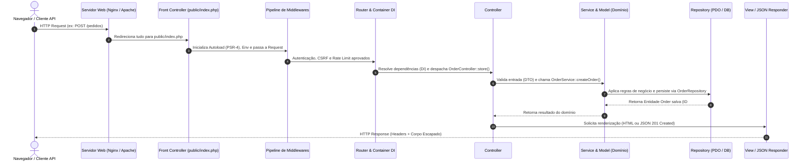

# Arquitetura MVC em PHP: Guia Definitivo (Do PHP 7.4 ao PHP 8.5)

Este diretório contém a documentação arquitetural completa da skill [`php-dev-expert`](../SKILL.md) sobre o padrão **MVC (Model-View-Controller)** aplicado ao desenvolvimento Web moderno em PHP.

O guia abrange desde a construção de uma estrutura **MVC pura (PHP Vanilla sem frameworks)** seguindo as recomendações da **PHP-FIG (PSRs)** até a evolução sintática entre o **PHP 7.4 e o PHP 8.5**, segurança em camadas, padrões complementares (**Service Layer**, **Repository**, **DTO**, **ADR**) e equivalências nos principais frameworks (**Laravel**, **Symfony**, **FlightPHP**, **Slim**).

---

## Índice da Documentação MVC

1. **[01 — Front Controller, Autoloading (PSR-4), Roteamento e Middlewares](01-front-controller-routing-psr.md)**
   - Ponto único de entrada (`public/index.php`), isolamento de segurança da raiz, regras de reescrita para Apache (`.htaccess`) e Nginx (`try_files`), configuração do Composer PSR-4, implementação de Router completo (com suporte a Attributes `#[Route]` no PHP 8+ e arrays no PHP 7.4) e pipeline de Middlewares.
2. **[02 — Camada Controller (`C`): Orquestração, Request/Response, DTOs e Validação](02-controllers-requests-validation.md)**
   - O papel real do Controller (*Skinny Controller*), objetos `Request` e `Response`, validação desacoplada, Data Transfer Objects (**DTOs**) do PHP 7.4 ao PHP 8.5, Injeção de Dependências via Container (PSR-11) e *Single-Action Controllers* (`__invoke` / ADR).
3. **[03 — Camada Model (`M`): Entidades, Services, Repositories e Persistência com PDO](03-models-services-repositories-pdo.md)**
   - A separação da camada Model em **Entidades de Domínio**, **Services (Casos de Uso)** e **Repositories (Persistência)**; comparativo *Active Record vs Data Mapper*; conexão segura com **PDO**; transações e prevenção absoluta contra SQL Injection.
4. **[04 — Camada View (`V`): Templates, Layouts, APIs JSON e Segurança (XSS / CSRF)](04-views-templates-security-xss-csrf.md)**
   - Motor de templates nativo em PHP com suporte a Layouts e Partials, escape contextual contra **XSS**, proteção contra **CSRF** com tokens criptográficos, serialização para APIs REST/JSON e integração com **Twig**, **Blade** e **Latte**.
5. **[05 — Evolução do MVC (PHP 7.4 ao 8.5), Frameworks, Anti-Patterns e Testes](05-evolution-php74-to-php85-and-frameworks.md)**
   - Comparativo prático de código MVC no PHP 7.4, 8.0, 8.1, 8.2, 8.3, 8.4 e 8.5 (Property Hooks, Asymmetric Visibility, Pipe Operator `|>`), mapeamento no Laravel/Symfony/FlightPHP, refatoração de *Anti-Patterns* (*God Controller*, *SQL na View*, *Anemic Model*) e testes unitários com PHPUnit.

---

## 1. O que é o Padrão MVC no Contexto Web PHP?

Originalmente concebido por Trygve Reenskaug (1979) para interfaces gráficas Desktop (Smalltalk-80), o **MVC** foi adaptado para a arquitetura *stateless* do protocolo HTTP (frequentemente chamado de **Web MVC** ou **Model 2**).

No PHP moderno, cada letra do acrônimo possui uma responsabilidade estrita e inegociável:

| Camada | Responsabilidade Principal | O que DEVE conter | O que NUNCA deve conter |
| :--- | :--- | :--- | :--- |
| **Model (`M`)** | Estado, regras de negócio, invariantes de domínio e acesso a dados. | Entidades (`User`, `Order`), Value Objects (`Email`, `Money`), Services (`CheckoutService`) e Repositories (`PdoOrderRepository`). | Acesso a `$_GET`/`$_POST`/`$_SESSION`, emissão de cabeçalhos HTTP (`header()`), ou geração de HTML. |
| **View (`V`)** | Apresentação visual ou formatação da resposta para o consumidor. | Templates HTML (`.php`, `.twig`, `.blade.php`), formatação de datas/moedas, escape anti-XSS (`htmlspecialchars`) ou estruturas JSON. | Consultas SQL (`SELECT * FROM...`), regras de negócio complexas ou mutação de estado no banco de dados. |
| **Controller (`C`)** | Coordenação entre a requisição HTTP recebida e a resposta devolvida. | Leitura do objeto `Request`, validação da entrada (ou delegação para DTO/FormRequest), chamada ao `Service`/`Model` e retorno da `View` ou `Response`. | Queries SQL cruas, cálculos financeiros de domínio ou concatenação manual de páginas HTML. |

---

## 2. Ciclo de Vida de uma Requisição em PHP MVC

Em uma aplicação PHP legada (sem MVC), o navegador acessava arquivos `.php` diretamente (`ex: /produtos/editar.php?id=10`), misturando conexão com banco, validação de sessão, `UPDATE` SQL e HTML no mesmo script.

Na arquitetura **PHP MVC**, todas as requisições passam por um fluxo único e previsível:



---

## 3. Estrutura de Diretórios Canônica (PHP MVC Moderno)

Uma estrutura profissional separa rigorosamente a pasta pública (`public/`) do código-fonte da aplicação (`app/` ou `src/`):

```text
meu-projeto-mvc/
├── app/                          # Código-fonte da aplicação (Namespace: App\)
│   ├── Controllers/              # Camada C: Recebe Request e retorna Response/View
│   │   ├── Controller.php        # Classe base abstrata opcional
│   │   ├── HomeController.php
│   │   └── UserController.php
│   ├── DTOs/                     # Objetos imutáveis de transporte de dados de entrada
│   │   └── CreateUserDTO.php
│   ├── Entities/                 # Camada M (Domínio): Entidades puras de negócio
│   │   └── User.php
│   ├── Enums/                    # Camada M (PHP 8.1+): Estados tipados de domínio
│   │   └── UserStatus.php
│   ├── Exceptions/               # Exceções de domínio e HTTP
│   │   └── DomainException.php
│   ├── Http/                     # Infraestrutura HTTP (Request, Response, Router, Kernel)
│   │   ├── Request.php
│   │   ├── Response.php
│   │   └── Router.php
│   ├── Middlewares/              # Filtros HTTP (Auth, Csrf, Cors)
│   │   ├── MiddlewareInterface.php
│   │   └── CsrfMiddleware.php
│   ├── Repositories/             # Camada M (Persistência): Contratos e implementações PDO
│   │   ├── UserRepositoryInterface.php
│   │   └── PdoUserRepository.php
│   └── Services/                 # Camada M (Aplicação/Negócio): Orquestração de casos de uso
│       └── UserService.php
├── config/                       # Arquivos de configuração (banco, app, rotas)
│   ├── database.php
│   └── routes.php
├── public/                       # ÚNICO diretório exposto pelo Nginx / Apache (DocumentRoot)
│   ├── assets/                   # CSS, JS, Imagens públicas
│   ├── .htaccess                 # Regra de reescrita (se usar Apache)
│   └── index.php                 # Front Controller (Ponto único de entrada)
├── resources/                    # Recursos de interface não expostos diretamente
│   └── views/                    # Camada V: Templates e Layouts HTML/PHP
│       ├── layouts/
│       │   └── main.php
│       └── users/
│           ├── index.php
│           └── show.php
├── storage/                      # Logs, cache de templates, sessões e uploads privados
│   ├── cache/
│   └── logs/
├── tests/                        # Testes automatizados (PHPUnit / Pest)
│   ├── Unit/
│   └── Feature/
├── .env                          # Variáveis de ambiente locais (NUNCA versionado no Git)
├── .env.example                  # Modelo de variáveis de ambiente
├── composer.json                 # Autoloading PSR-4 e dependências
└── phpunit.xml                   # Configuração da suíte de testes
```

> [!IMPORTANT]
> **Regra de Ouro de Segurança:** O `DocumentRoot` (no Apache) ou `root` (no Nginx) do servidor web deve apontar **exclusivamente** para a pasta `public/`. Dessa forma, mesmo que ocorra uma falha de configuração no interpretador PHP, um invasor jamais conseguirá baixar o arquivo `.env`, `config/database.php` ou classes de `app/` via URL.

---

## 4. Padrões da PHP-FIG (PSRs) Relacionados ao MVC

Ao construir ou avaliar uma arquitetura MVC em PHP, utilize as especificações oficiais da **PHP-FIG**:

- **PSR-4 (Autoloader):** Mapeamento automático de namespaces (`App\Controllers\UserController`) para caminhos de arquivos (`app/Controllers/UserController.php`) sem usar `require_once` manual espalhado pelo código.
- **PSR-7 (HTTP Message Interfaces):** Padronização de objetos imutáveis `RequestInterface`, `ServerRequestInterface` e `ResponseInterface`.
- **PSR-11 (Container Interface):** Padronização do Container de Injeção de Dependências (`$container->get(UserController::class)`).
- **PSR-12 / PER Coding Style:** Padronização de estilo e formatação de código PHP.
- **PSR-15 (HTTP Server Request Handlers):** Padronização de Middlewares (`MiddlewareInterface`) e tratadores de requisição (`RequestHandlerInterface`).
- **PSR-14 (Event Dispatcher):** Desacoplamento de efeitos colaterais no domínio (ex: disparar `UserRegisteredEvent` após salvar no Model sem poluir o Controller com envio de e-mails).

---

## Próximos Passos

Comece pelo **[Capítulo 01 — Front Controller, Autoloading (PSR-4), Roteamento e Middlewares](01-front-controller-routing-psr.md)** para ver a implementação completa da base da arquitetura.

