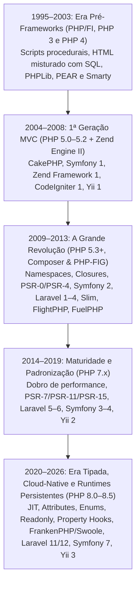

# 01 — História e Evolução dos Frameworks PHP (1995–2026)

Voltar para o [Índice de Frameworks PHP](README.md)

---

## Linha do Tempo Evolutiva

---

## Fase 1: A Era Pré-Frameworks e as Primeiras Bibliotecas (1995–2003)

Quando Rasmus Lerdorf criou o **PHP/FI (1995)** e Zeev Suraski e Andi Gutmans reescreveram o interpretador no **PHP 3 (1998)** e **PHP 4 (2000 — Zend Engine 1)**, o objetivo do PHP era ser a forma mais direta de conectar páginas HTML a bancos de dados como MySQL.

- **Como se programava:** Cada página do site era um arquivo físico (`login.php`, `carrinho.php`, `finalizar.php`). Reutilização de código era feita com `include 'cabecalho.php'` e `require_once 'funcoes.php'`.
- **Os Primeiros Precursores:**
  - **PHPLib (1998):** Uma das primeiras tentativas de padronizar autenticação, gerenciamento de sessões e templates no PHP 3.
  - **PEAR (PHP Extension and Application Repository — 1999):** Primeiro repositório oficial de pacotes reutilizáveis (`PEAR::DB`).
  - **Smarty Template Engine (2001):** Criado para separar o HTML do código PHP, introduzindo o conceito da camada **View** antes mesmo de os frameworks MVC se popularizarem.
  - **Fusebox, Mojavi e Horde (2001–2003):** Primeiros experimentos de arquitetura Front Controller e ações estruturadas em PHP 4.

> **Limitação da época:** No PHP 4, objetos eram copiados por valor (e não por referência), não existiam interfaces, nem `private`/`protected` reais, nem exceções (`try/catch`), tornando padrões avançados de POO difíceis e lentos.

---

## Fase 2: O PHP 5.0 e a 1ª Geração de Frameworks MVC (2004–2008)

Em **julho de 2004**, o lançamento do **PHP 5.0 (Zend Engine II)** mudou tudo: o PHP ganhou um modelo de Orientação a Objetos completo (inspirado no Java/C++), além do **PDO (PHP Data Objects)** e da API de **Reflection**.

Quase simultaneamente, David Heinemeier Hansson lançou o **Ruby on Rails (2004/2005)**, popularizando os conceitos de *Convention over Configuration* (Convenção sobre Configuração), *Active Record* e *Scaffolding* via linha de comando. A comunidade PHP respondeu imediatamente criando a **Primeira Geração de Grandes Frameworks MVC**:

1. **CakePHP (2005):** O pioneiro em trazer a filosofia do Ruby on Rails para o PHP ("Rapid Application Development"), com convenções rígidas de nomes, ORM Active Record próprio e geração automática de código (*Bake*).
2. **Symfony 1 (2005):** Criado por Fabien Potencier (SensioLabs) na França, combinou ideias do framework Java *Mojavi* com o ORM *Propel* (e depois *Doctrine*), tornando-se rapidamente o padrão para grandes portais corporativos europeus.
3. **Zend Framework 1 (2006):** Liderado pela própria Zend Technologies (empresa de Andi Gutmans e Zeev Suraski), focou em arquitetura *Enterprise* estilo "use-at-will" (componentes soltos, altamente configuráveis).
4. **CodeIgniter (2006):** Criado por Rick Ellis (EllisLab), conquistou uma legião de desenvolvedores por ser **extremamente rápido, leve, sem exigir linha de comando** e com uma documentação impecável, ideal para hospedagens compartilhadas da época.
5. **Yii Framework 1.0 (2008):** Criado por Qiang Xue (fundador do Prado Framework), destacou-se pelo gerador visual de código (**Gii**), altíssima performance e integração pronta com jQuery.

---

## Fase 3: A Revolução do PHP 5.3, Composer e PHP-FIG (2009–2013)

Até 2009, os frameworks PHP eram **"ilhas isoladas"**: era muito difícil usar um componente do Zend dentro de um projeto CakePHP ou Symfony 1, porque não havia namespaces nem um gerenciador de dependências unificado.

Três marcos transformaram o PHP para sempre:

1. **PHP 5.3 (2009):** Introduziu **Namespaces** (`namespace App\Controllers;`), **Closures / Funções Anônimas** (`function ($req) {}`) e **Late Static Bindings** (`static::`).
2. **Fundação da PHP-FIG (2009):** Os autores dos principais frameworks se reuniram para criar as **PSRs (PHP Standards Recommendations)**, começando pela **PSR-0** e depois **PSR-4** (padrão universal de Autoloading).
3. **Composer & Packagist (2011–2012):** Criados por Nils Adermann e Jordi Boggiano, extinguiram o hábito de baixar arquivos `.zip` de bibliotecas manualmente e inauguraram a era de **componentes desacoplados**.

Essa revolução deu origem à **Segunda Geração de Frameworks**:
- **Symfony 2 (2011):** Reescrito do zero como uma coleção de **Componentes Desacoplados** (`HttpFoundation`, `Routing`, `Console`, `EventDispatcher`, `DependencyInjection`), que passaram a servir de base para dezenas de outros projetos (incluindo Laravel, Drupal 8+, Magento, phpBB).
- **Slim Framework (2010) & FlightPHP (2011):** Aproveitaram as *Closures* do PHP 5.3 para trazer o estilo de **Micro-Frameworks** (inspirado no Sinatra do Ruby e Express.js do Node): `Flight::route('GET /hello', function() { ... });`.
- **FuelPHP (2011):** Criado por Dan Horrigan, Phil Sturgeon e equipe, nasceu focado no PHP 5.3+ com arquitetura **HMVC (Hierarchical Model-View-Controller)** nativa e segurança em primeiro lugar.
- **Laravel (2011):** Criado por Taylor Otwell inicialmente como uma alternativa mais expressiva e moderna ao CodeIgniter (que na época demorava a adotar os recursos do PHP 5.3). Com o **Laravel 4 (2013)**, Taylor reestruturou o framework sobre o **Composer** e os componentes do **Symfony**, combinando o **Eloquent ORM**, o motor **Blade**, filas, eventos e uma experiência de desenvolvedor (DX) que o tornou o framework PHP mais popular do mundo.

---

## Fase 4: A Era da Performance (PHP 7.x) e das PSRs HTTP (2014–2019)

Com o lançamento do **PHP 7.0 (dezembro de 2015 — projeto PHPNG)**, o consumo de memória caiu pela metade e a velocidade de execução mais que dobrou. Simultaneamente, a PHP-FIG aprovou padrões que unificaram a infraestrutura HTTP:

- **PSR-7 (2015):** Interfaces de mensagens HTTP imutáveis (`ServerRequestInterface`, `ResponseInterface`).
- **PSR-11 (2017):** Interface padrão para Containers de Injeção de Dependência (`ContainerInterface`).
- **PSR-15 (2018):** Padrão oficial de *HTTP Server Request Handlers* e *Middlewares*.

Frameworks como **Slim 3/4**, **Laminas (sucessor do Zend Framework)** e **Yii 2/3** adotaram essas PSRs diretamente no núcleo, permitindo que um mesmo Middleware escrito para o Slim funcionasse sem alterações no Mezzio ou no Symfony.

---

## Fase 5: A Era Moderna — Tipagem Estrita, PHP 8.x e Runtimes Persistentes (2020–2026)

Do **PHP 8.0 (2020)** ao **PHP 8.5 (2025/2026)**, a linguagem incorporou recursos de engenharia de software de ponta: **JIT Compiler**, **Attributes** (`#[Route]`), **Enums**, **Readonly Classes**, **Fibers**, **Property Hooks** (8.4), **Asymmetric Visibility** (8.4) e **Pipe Operator `|>`** (8.5).

Os frameworks evoluíram em três direções principais:
1. **Metaprogramação Limpa com Attributes:** Substituição de arquivos YAML/XML ou docblocks `@Route` por atributos nativos do PHP 8 (`#[Route('/api/users', methods: ['POST'])]`, `#[Autowire]`, `#[MapRequestPayload]`).
2. **Estrutura Enxuta e Zero-Config:** O **Laravel 11/12**, o **Symfony 6/7** e o **FlightPHP v3** reduziram drasticamente a quantidade de arquivos de configuração iniciais, priorizando convenções inteligentes e tipagem estática compatível com **PHPStan (Nível 9/10)** e **Psalm**.
3. **Execução Assíncrona e Runtimes Persistentes em Memória:** Além do modelo tradicional PHP-FPM (*Share-Nothing*, onde o framework é inicializado e destruído a cada requisição), os frameworks modernos suportam execução contínua em memória via **FrankenPHP (Caddy)**, **Swoole / OpenSwoole**, **RoadRunner** e **Laravel Octane**, alcançando dezenas de milhares de requisições por segundo com latência sub-milissegundo.

---

## Próximo Capítulo

Avance para **[02 — Anatomia Interna, Comparativo Técnico e Matriz de Decisão](02-arquitetura-comparativo-e-quando-usar.md)**.

