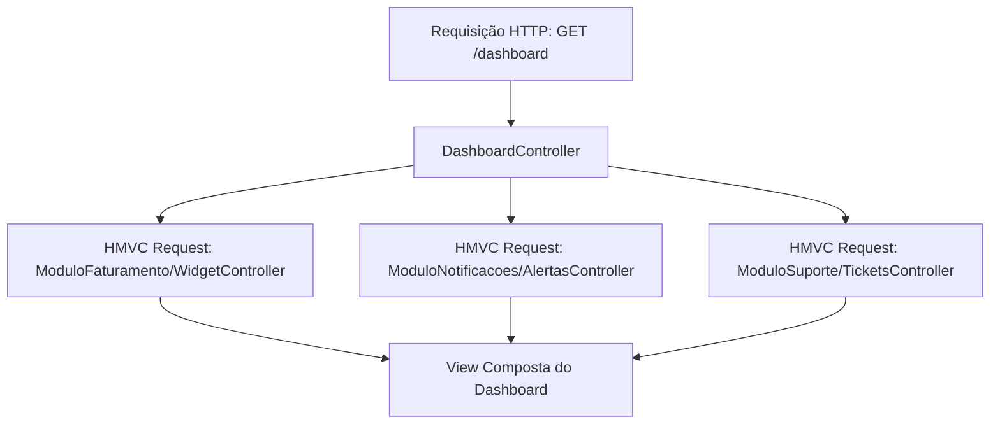

# 02 — Anatomia Interna, Comparativo Técnico e Matriz de Decisão

Voltar para o [Índice de Frameworks PHP](README.md) | Anterior: [01 — História e Evolução](01-historia-e-evolucao-dos-frameworks-php.md)

---

## 1. Full-Stack Frameworks vs Micro-Frameworks

Os frameworks PHP dividem-se em duas grandes famílias arquiteturais:

### A. Full-Stack Frameworks ("Batteries-Included")
Entregam uma pilha completa e integrada para aplicações de ponta a ponta: Roteamento, ORM, Motor de Templates, Autenticação, Autorização (ACL/Gates), Filas, E-mail, Storage, Validação, CLI e Testes.
- **Exemplos documentados nesta skill:** **Laravel**, **Symfony**, **Yii Framework**, **CodeIgniter**, **FuelPHP**.
- **Vantagens:** Altíssima velocidade para entregar produtos completos; padrões de código consistentes em toda a equipe; ecossistema oficial vasto.
- **Cuidados:** Maior consumo base de memória e maior número de pacotes na árvore do `vendor/`.

### B. Micro-Frameworks ("Minimalist & Composable")
Focam no núcleo essencial do ciclo HTTP: **Receber uma Requisição -> Executar Middlewares -> Despachar a Rota -> Retornar uma Resposta**, deixando a escolha de ORM, Template Engine e Validação 100% livre para o arquiteto do projeto.
- **Exemplos documentados nesta skill:** **FlightPHP v3**, **Slim Framework v4**, **Web-Framework**.
- **Vantagens:** Footprint mínimo de CPU e RAM (frequentemente 5x a 10x mais rápidos no bootstrap em PHP-FPM tradicional); curva de aprendizado imediata; ideais para **APIs RESTful, Microsserviços, Webhooks, BFFs (Backend-for-Frontend)** e servidores com recursos restritos.

---

## 2. Comparativo Técnico dos Frameworks Documentados

| Framework | Arquitetura Base | ORM / Banco Padrão | Template Engine | Injeção de Dependência | Melhor Caso de Uso |
| :--- | :--- | :--- | :--- | :--- | :--- |
| **[Laravel](../laravel/_INDEX.md)** | MVC + Service Providers + Actions | **Eloquent ORM** (Active Record) | **Blade** / Inertia / Livewire | Service Container próprio (PSR-11) | SaaS, ERPs, Monolitos Modernos, Startups de alta velocidade de entrega. |
| **[Symfony](../symfony/_INDEX.md)** | HttpKernel + EventDispatcher + MVC/ADR | **Doctrine ORM** (Data Mapper) | **Twig** | Symfony DI Container compilado (PSR-11) | Sistemas corporativos críticos, DDD (Domain-Driven Design), projetos de longa duração (LTS). |
| **[Yii (v2 / v3)](../yii/_INDEX.md)** | MVC estrito orientado a componentes / PSRs (v3) | **ActiveRecord** (v2) / **Cycle ORM & ActiveRecord** (v3) | Views PHP nativas / Twig | Yii DI Container (PSR-11 no Yii 3) | Portais administrativos, CRUDs complexos de alta performance e APIs corporativas. |
| **[CodeIgniter (v4)](../codeigniter/_INDEX.md)** | MVC Clássico enxuto | **CodeIgniter Model** + Query Builder | Views PHP nativas / View Parser | `Config\Services` (Service Locator leve) | Sistemas web rápidos, migração de legados, ambientes com baixo consumo de recursos. |
| **[FuelPHP](../fuelphp/_INDEX.md)** | **HMVC** (Hierarchical MVC) | **Fuel ORM** (Active Record) | Views PHP / Parser (Twig/Mustache) | Container e classes `Core` extensíveis | Sistemas modulares onde widgets/módulos executam sub-requisições HMVC internas. |
| **[Slim (v4)](../slim/_INDEX.md)** | Micro-Framework **PSR-7 + PSR-15** puro | Livre (PDO, Eloquent, Doctrine) | Livre (Twig-View, PHP-View) | Qualquer container **PSR-11** (PHP-DI, League) | Microsserviços, APIs REST padronizadas nas PSRs da PHP-FIG, Gateways HTTP. |
| **[FlightPHP (v3)](../flightphp/_INDEX.md)** | Micro-Framework Extensível (MVC/ADR) | **SimplePdo** / **Active Record** nativo ou PDO | **Latte**, **Twig** ou Views nativas | `flightphp/container` (Dice / PSR-11) | APIs ultrarrápidas, sistemas enxutos sem overhead, projetos com IA/MCP integrado. |
| **[Fat-Free Framework (F3 v3.9)](../fatfree/_INDEX.md)** | Micro-Framework *Batteries-Included* (~65KB) | **SQL/Jig/Mongo Data Mappers** nativos (`DB\SQL\Mapper`) | **F3 Template Engine** (`<include>`, `<repeat>`) | Hive global (`Base::instance()`) ou Container | Aplicações ultraleves que precisam de ORM multi-banco (SQL, NoSQL, Flat-file) e motor de templates nativo sem dependências externas. |
| **[Spiral](../spiral/SKILL.md)** | Híbrido PHP + Go (**RoadRunner**), Bootloaders, Interceptors | **Cycle ORM** (Data Mapper) | **Stempler** / **Twig** | Spiral Container (Auto-wiring + Scopes para Workers de longa duração) | Microsserviços de altíssima concorrência, gRPC, Filas, Temporal workflows e aplicações Cloud-Native. |
| **[Web-Framework](../web-framework/_INDEX.md)** | Arquitetura Web Modular | Modular / Desacoplado | Modular | Container DI | Referência de construção e estruturação de aplicações web modernas. |

---

## 3. O Que é HMVC (Usado no FuelPHP e Arquiteturas Modulares)?

Enquanto o **MVC tradicional** processa uma única tríade `Controller -> Model -> View` por requisição HTTP, o padrão **HMVC (Hierarchical Model-View-Controller)** transforma cada módulo da aplicação em uma tríade MVC independente que pode ser invocada internamente por outro Controller sem passar novamente pela rede HTTP:

---

## 4. Matriz de Decisão: Como Escolher o Framework Ideal?

Use este guia prático ao iniciar ou recomendar uma arquitetura ao usuário:

1. **Precisa construir uma API REST enxuta, um Webhook receiver, um Microsserviço de baixa latência ou rodar em hardware/containers enxutos?**
   - Escolha **[FlightPHP v3](../flightphp/_INDEX.md)** (se quiser bateria leve inclusa como `SimplePdo`, roteamento expressivo e zero burocracia) ou **[Slim v4](../slim/_INDEX.md)** (se exigir aderência estrita a middlewares PSR-7/PSR-15).
2. **Vai desenvolver um SaaS completo com painel administrativo, autenticação, filas de e-mail, cobrança recorrente e equipe focada em velocidade de entrega?**
   - Escolha **[Laravel](../laravel/_INDEX.md)**.
3. **Vai desenvolver um sistema financeiro/corporativo com regras de domínio complexas (DDD), entidades desacopladas do banco (Data Mapper) e contrato de suporte de longo prazo (LTS)?**
   - Escolha **[Symfony](../symfony/_INDEX.md)** (ou **[Yii 3](../yii/_INDEX.md)**).
4. **Precisa de um framework Full-Stack extremamente leve, com baixa curva de aprendizado e excelente performance em servidores tradicionais?**
   - Escolha **[CodeIgniter 4](../codeigniter/_INDEX.md)** ou **[Yii 2](../yii/_INDEX.md)**.
5. **Está mantendo ou evoluindo uma aplicação modular baseada em HMVC?**
   - Consulte a documentação do **[FuelPHP](../fuelphp/_INDEX.md)**.

---

## Referências Internas na Skill `php-dev-expert`

- [Índice Principal de Frameworks](README.md)
- [Guia Completo de Arquitetura PHP MVC (`../../MVC/README.md`)](../../MVC/README.md)
- [Segurança Crítica & Blindagem PHP2Shell (`../../security-cves.md`)](../../security-cves.md)
- [Guias de Servidores Web (`../../servers/`)](../../servers/)

