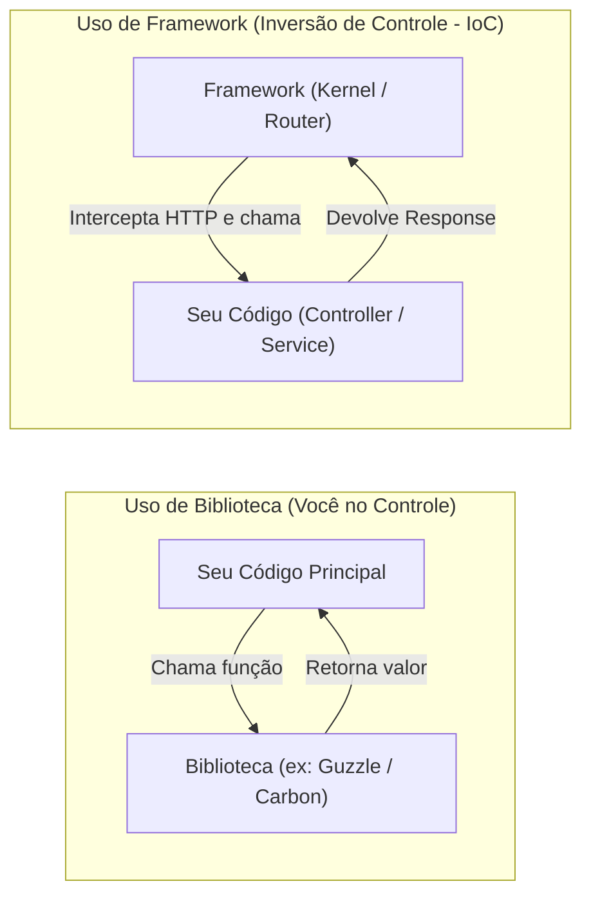

# Frameworks PHP: O Que São, Como Surgiram e Para Que Servem

Este diretório (`frameworks/doc/`) reúne a fundamentação teórica, histórica e arquitetural sobre **Frameworks no ecossistema PHP**, servindo como ponto de partida para as documentações oficiais completas armazenadas em [`php-dev-expert/frameworks/`](../).

---

## Sumário da Documentação Conceitual (`frameworks/doc/`)

1. **[Visão Geral: O Que é um Framework, Inversão de Controle e Para Que Serve](README.md)** *(Este documento)*
2. **[01 — História e Evolução dos Frameworks PHP (1995–2026)](01-historia-e-evolucao-dos-frameworks-php.md)**
   - Da era do *Spaghetti Code* no PHP 3/4 ao impacto do Ruby on Rails (2005), o nascimento do Composer e da PHP-FIG (2009–2012), a consolidação do Laravel/Symfony e a era moderna de alta concorrência no PHP 8.x.
3. **[02 — Anatomia Interna, Comparativo Técnico e Matriz de Decisão](02-arquitetura-comparativo-e-quando-usar.md)**
   - Comparação detalhada entre **Full-Stack Frameworks** (Laravel, Symfony, Yii, CodeIgniter, FuelPHP) e **Micro-Frameworks** (FlightPHP, Slim, Web-Framework), além de critérios objetivos para escolher a ferramenta certa para cada projeto.

---

## Índice de Documentações Oficiais em `php-dev-expert/frameworks/`

| Framework | Categoria | Diretório Local de Documentação | Fonte Oficial |
| :--- | :--- | :--- | :--- |
| **Laravel** | Full-Stack MVC / Enterprise | [`../laravel/_INDEX.md`](../laravel/_INDEX.md) | https://laravel.com/docs |
| **Symfony** | Full-Stack & Componentes Desacoplados | [`../symfony/_INDEX.md`](../symfony/_INDEX.md) | https://symfony.com/doc |
| **Yii Framework (v2 & v3)** | Full-Stack de Alta Performance | [`../yii/_INDEX.md`](../yii/_INDEX.md) | https://www.yiiframework.com / https://yiisoft.github.io/docs/guide/ |
| **CodeIgniter (v4)** | Full-Stack Leve e Rápido | [`../codeigniter/_INDEX.md`](../codeigniter/_INDEX.md) | https://codeigniter.com/user_guide/index.html |
| **FuelPHP** | Full-Stack HMVC (Hierarchical MVC) | [`../fuelphp/_INDEX.md`](../fuelphp/_INDEX.md) | https://www.fuelphp.com/docs/ & `/api/` |
| **Slim Framework (v4)** | Micro-Framework PSR-7 / PSR-15 | [`../slim/_INDEX.md`](../slim/_INDEX.md) | https://www.slimframework.com/docs/v4/ |
| **FlightPHP (v3)** | Micro-Framework Extensível e Ultrarrápido | [`../flightphp/_INDEX.md`](../flightphp/_INDEX.md) | https://docs.flightphp.com/pt/v3/ |
| **Fat-Free Framework (F3 v3.9)** | Micro-Framework Full-Featured (Router + ORM/Mapper + Template) | [`../fatfree/_INDEX.md`](../fatfree/_INDEX.md) | https://fatfreeframework.com/3.9/user-guide |
| **[Spiral Framework](../spiral/SKILL.md)** | Full-Stack Cloud-Native & RoadRunner (Go + PHP) | [`../spiral/_INDEX.md`](../spiral/_INDEX.md) • [`SKILL.md`](../spiral/SKILL.md) | https://spiral.dev/docs |
| **Web-Framework** | Arquitetura / Framework Web Moderno | [`../web-framework/_INDEX.md`](../web-framework/_INDEX.md) | https://web-framework.com/ |

---

## 1. O Que é um Framework?

Um **Framework** (arcabouço ou estrutura de trabalho) é uma plataforma de software reutilizável que fornece uma **arquitetura padronizada**, um **fluxo de execução pré-definido** e um conjunto de **componentes prontos** para resolver problemas recorrentes do desenvolvimento de aplicações (roteamento HTTP, acesso a banco de dados, autenticação, validação, cache, filas e segurança).

### A Diferença Fundamental: Biblioteca (*Library*) vs Framework

Muitos desenvolvedores confundem uma **Biblioteca** (ex: `guzzlehttp/guzzle`, `monolog/monolog`) com um **Framework** (ex: Laravel, Symfony, Slim, FlightPHP). A diferença está na **Inversão de Controle (IoC — Inversion of Control)**, também conhecida como o **Princípio de Hollywood** (*"Não nos ligue, nós ligaremos para você"*):

- **Na Biblioteca:** O **seu código** controla o fluxo da aplicação e decide quando chamar a biblioteca.
- **No Framework:** O **framework** controla o ciclo de vida da requisição HTTP (recebe a chamada no *Front Controller*, passa pelos *Middlewares*, resolve dependências via *Container DI* e **chama o seu Controller** no momento exato).

---

## 2. Como os Frameworks PHP Surgiram? (Resumo Executivo)

No final dos anos 1990 e início dos anos 2000 (PHP 3 e PHP 4), o PHP cresceu de forma explosiva porque permitia embutir tags `<?php ... ?>` diretamente dentro de arquivos `.html`. Contudo, à medida que sistemas corporativos e e-commerces cresceram, essa facilidade gerou três grandes crises:

1. **O Caos do *Spaghetti Code*:** Cada arquivo `.php` conectava ao MySQL, lia `$_POST` sem validação, processava regras de pagamento e imprimia `<table>` HTML no mesmo script de 3.000 linhas.
2. **Vulnerabilidades Sistêmicas:** A falta de abstrações padronizadas fazia com que cada programador tentasse proteger (ou esquecesse de proteger) queries SQL e saídas HTML manualmente, gerando epidemias de **SQL Injection**, **XSS** e **CSRF**.
3. **Reinvenção da Roda a Cada Projeto:** Toda equipe gastava as primeiras semanas de um projeto escrevendo seu próprio sistema de login, paginação, envio de e-mail e roteamento de URLs.

Com o lançamento do **PHP 5.0 (2004)** — que introduziu o motor **Zend Engine II** com Orientação a Objetos real (visibilidade `public`/`protected`/`private`, interfaces, classes abstratas, exceções `try/catch`, `PDO` e Reflection) — e a inspiração do **Ruby on Rails (2004/2005)**, surgiram os primeiros frameworks MVC em PHP (**CakePHP**, **Symfony 1**, **Zend Framework**, **CodeIgniter**, **Yii**), seguidos em 2011–2012 pela revolução do **Composer** e da **PHP-FIG (PSRs)**, que deram origem à geração atual (**Symfony 2–7**, **Laravel**, **Slim**, **FlightPHP v3**, **Yii 2/3**).

*(Leia a narrativa histórica completa em **[01 — História e Evolução dos Frameworks PHP](01-historia-e-evolucao-dos-frameworks-php.md)**.)*

---

## 3. Para Que Servem os Frameworks PHP? (Os 7 Pilares)

Adotar um framework em PHP resolve simultaneamente problemas técnicos e organizacionais:

### 1. Padronização Arquitetural e Onboarding Rápido
Em um projeto sem framework (ou com um "framework caseiro" não documentado), um novo desenvolvedor leva semanas para entender onde ficam as rotas, como os erros são tratados e como o banco é consultado. Em um projeto **Laravel**, **Symfony**, **CodeIgniter** ou **Slim**, qualquer engenheiro PHP experiente sabe exatamente onde encontrar Controllers, Rotas, Migrations e Testes no primeiro dia.

### 2. Segurança *By Default* (Blindagem Nativa)
Os frameworks modernos já entregam proteções ativadas por padrão contra as falhas mais críticas da **OWASP Top 10**:
- **Prevenção de SQL Injection:** Query Builders e ORMs (Eloquent, Doctrine, Active Record) utilizam *Prepared Statements* via PDO automaticamente.
- **Prevenção de XSS (Cross-Site Scripting):** Engines como Blade (`{{ $var }}`), Twig (`{{ var }}`) e Latte (`{$var}`) escapam todas as variáveis automaticamente.
- **Proteção contra CSRF:** Tokens criptográficos de sessão verificados por middleware em todas as requisições `POST`/`PUT`/`DELETE`.
- **Criptografia e Hashing de Senhas:** Integração nativa com Bcrypt e Argon2id (`password_hash`).

### 3. Roteamento HTTP Avançado e Pipeline de Middlewares
Transformam URLs em ações tipadas com suporte a grupos de rotas, parâmetros validados por Regex, *Rate Limiting*, negociação de conteúdo JSON/HTML e camadas de *Middlewares* (PSR-15) para autenticação (JWT, OAuth2, Session) e CORS.

### 4. Injeção de Dependências (DI Container) e Desacoplamento
Através de um Container de Inversão de Controle (PSR-11), o framework resolve automaticamente as dependências declaradas no construtor das suas classes (*Auto-Wiring*), facilitando a aplicação dos princípios **SOLID**.

### 5. Abstração de Banco de Dados, Migrations e Seeders
Permitem versionar a estrutura do banco de dados em código PHP (*Migrations*), trocar entre MySQL, PostgreSQL, SQLite e SQL Server com impacto mínimo, e popular dados de teste (*Seeders* e *Factories*).

### 6. Ecossistema de Infraestrutura Pronta (Filas, Cache, Eventos, CLI)
Sistemas reais precisam de mais do que apenas "mostrar páginas": precisam enviar e-mails em segundo plano (**Queues/Workers** com Redis/RabbitMQ), armazenar sessões distribuídas (**Cache** PSR-6/PSR-16), agendar tarefas (**Task Scheduling / Cron**) e expor comandos de terminal (**CLI** como `artisan` ou `bin/console`).

### 7. Testabilidade Automatizada de Ponta a Ponta
Frameworks fornecem *Test Helpers* para simular requisições HTTP (`$this->postJson('/api/orders', [...])->assertStatus(201)`), substituir serviços externos por *Mocks/Fakes* (e-mail, storage S3, filas) e rodar transações de banco que fazem *rollback* automático ao fim de cada teste.

---

## Próximos Capítulos

- Continue para **[01 — História e Evolução dos Frameworks PHP (1995–2026)](01-historia-e-evolucao-dos-frameworks-php.md)**
- Ou consulte **[02 — Anatomia Interna, Comparativo Técnico e Matriz de Decisão](02-arquitetura-comparativo-e-quando-usar.md)**

